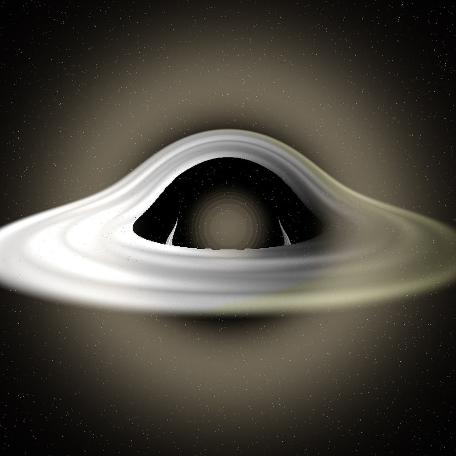

# example_blackhole

A Schwarzschild black hole with gravitational lensing, a Doppler-beamed accretion disk and a procedural starfield.

| | |
|---|---|
| Group | `rendering` |
| Sources | `src/rendering/blackhole.cpp` |
| Backends | dx, vk, cuda |
| Build | `xmake build example_blackhole` |
| Run | `example_blackhole dx --headless --capture blackhole.jpg` |



## Purpose

One screen-filling kernel, no geometry at all: every pixel bends its own light ray
around a point mass, and where the ray crosses the disk plane it picks up thermal
emission. The picture is the well-known warped disk — the far side of the disk
lifted over the shadow, the approaching side brighter than the receding one —
produced by integrating a curved ray rather than by any mesh or texture.

## Architecture

- **Parameters.** Five constants describe the scene: `bh_mass = 1`,
  `bh_radius = 2` (the Schwarzschild radius), `photon_sphere = 3`,
  `accretion_inner = 6` and `accretion_outer = 15`. The camera defaults to a
  distance of 30 with a small tilt.
- **Camera as kernel arguments.** `blackhole_kernel` takes
  `(image, rot_x, rot_y, roll_angle, cam_distance, time)`. Each dispatch
  re-derives the camera position from the two orbit angles, builds `forward`,
  `right` and `up`, applies the roll to the basis, and shoots a ray through the
  pixel with a `0.6` field of view. Nothing is uploaded to a buffer, so orbiting
  costs no rebinding.
- **Curved rays.** The marching loop runs up to `max_steps = 300` with a fixed
  `dt = 0.25`. Each step tests `length(pos) < bh_radius * 1.01` for capture,
  accumulates the acceleration `-1.5 * bh_mass / r³ * pos` into the direction and
  renormalises it — a Newtonian stand-in for the geodesic that reproduces the
  photon sphere and the lensed ring.
- **Accretion disk.** A ray that crosses the `y = 0` plane between
  `accretion_inner` and `accretion_outer` samples the disk at the interpolated
  crossing point: Keplerian speed `sqrt(bh_mass / r)`, temperature profile
  `T ∝ r^(-0.75)`, blackbody-ish colour ramp, Doppler beaming
  `(1 + doppler * v * 2)²` plus a gravitational redshift factor, and a procedural
  spiral/turbulence pattern driven by `time`. The crossing is recorded once as the
  back side and once as the front side so the front surface wins.
- **Sky and glow.** Outside the disk the ray returns `get_star_color(dir)`, a three
  octave `fract(sin(...))` star hash with a slow twinkle, and a glow term that
  brightens rays whose impact parameter is close to the photon sphere.
- **Output.** The colour is tone mapped with `color / (color + 1) * 1.5` and
  clamped before `image.write`. One compiled shader
  (`device.compile(blackhole_kernel)`), a 1024×1024 `BYTE4` image, 16×16 blocks.
- **Offline path.** `--headless` dispatches the kernel once with `time = 0`,
  reads the image back with `display.copy_to(host_image)` and writes
  `test_blackhole.png` — a single frame, there is no sample accumulation. The
  optional `--compare` uses a slightly looser PSNR threshold (29.5 dB) because the
  star hash amplifies per-backend floating-point differences.

## Usage

```bash
example_blackhole dx                          # window: left drag orbits, right drag rolls, scroll zooms
example_blackhole dx --headless --capture blackhole.jpg
```

| Option | Meaning |
|---|---|
| `--headless`, `--offline` | no window: render one frame, write the image, exit |
| `--capture <file>` | write the picture to exactly this file; the container follows the extension; implies the headless path |
| `--output-dir DIR` | directory for the default output `test_blackhole.png` |
| `--compare <file>`, `-c` | compare the result with a reference image, non-zero exit on mismatch |

Interactive controls: left drag orbits, right drag rolls the image plane, the
scroll wheel or `+`/`-` changes the distance between 10 and 100, `ESC` quits.

## Result

A dark disk-shaped shadow ringed by a thin bright photon ring, an accretion disk
warped over and under it, one side brighter from Doppler beaming, in front of a
sparse starfield. It renders in milliseconds, which is what makes orbiting usable.

```
Running in offline mode
Headless black hole render finished: 1 frame, wrote 'blackhole.jpg'.
```

## See also

`example_path_tracing_camera` and `example_sdf_renderer` for the other
camera-driven renderers in this group.
