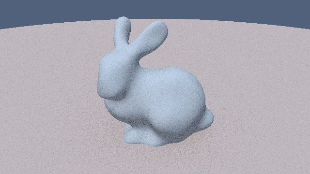

# example_coro_external_stage_neural_sdf

Path tracer whose distance and normal queries are answered by external stages, keeping a neural bunny SDF outside the coroutine.

| | |
|---|---|
| Group | `coro` |
| Sources | `src/coro/external_stage_neural_sdf.cpp`, `src/coro/neural_bunny_sdf.h`, `src/common/headless.h` |
| Backends | dx, vk, cuda |
| Build | `xmake build example_coro_external_stage_neural_sdf` |
| Run | `example_coro_external_stage_neural_sdf dx --headless --frames 1 --capture coro_neural_sdf.jpg` |



## Purpose

A complete renderer on the external-stage protocol: every pixel is a coroutine
that sphere-traces a learned signed distance field, and the network runs as device
work in two registered stages, one for the distance and one for the normal. It
shows how an expensive query becomes a suspension point with typed bindings.

## Architecture

- **The learned scene (`neural_bunny_sdf.h`).** `make_neural_bunny_sdf()` returns
  a `Callable<float(float3)>`, the reference GLSL network transcribed with the same
  column-major `mat4` layers; `make_neural_bunny_scene(bunny)` wraps it as
  `Callable<float2(float3)>` = `(distance, material)` and
  `make_neural_bunny_normal(scene)` derives `Callable<float3(float3)>` by finite
  differences. Before rendering, `validate_neural_sdf_values` checks eight probe
  points against host values of the original shader (tolerance 2e-4), which catches
  a transcription that is smooth but describes another surface.
- **Coroutine body and suspend sites.** `Coroutine<void(Image<float>,
  Buffer<uint>)>` runs one thread per pixel of a 640×360 image, with the reference
  camera (origin pitched by 0.5 rad, Y flipped because the PNG receives row 0 as
  the top scanline), two bounces of up to 96 march steps, world radius 8, one
  fixed light and a cosine-sampled bounce from a hash-based `random(UInt &)`. The
  march step suspends with `coro_stage(...distance...).read("point",
  query).write("sample", sample)`, the shading step with `...normal...` and a
  `normal` output, so only those values cross the boundary: the weights never
  enter a continuation and no route/resume loop is needed.
- **External stage.** `NeuralSdfFacade` is one facade for both schemas, returning a
  handler that writes `sample` or one that writes `normal`, both built by
  `_prepare_stage`. Each handler compiles a `Kernel1D` that reconstructs the frame
  with `reconstruct_slots`, evaluates its callable and commits `required_def.slots`
  through `coro_frame_store`; the scheduler reports both as handler `neural-sdf`.
- **Scheduler and stream.** `WavefrontCoroScheduler<Image<float>, Buffer<uint>>`
  with `thread_count = width * height`, `gather_by_sorting`,
  `frame_buffer_compaction = false`, `execution_block_size = 256` and
  `incremental_continuation_counts`. Frames parked at `neural_distance` and
  `neural_normal` form separate queues, and the host selects whichever queue is
  non-empty until every path terminates; `--frames N` repeats that dispatch on the
  compute `Stream`.
- **Output.** HDR image and hit mask are copied back and validated: all values
  finite, between 5 % and 95 % of the pixels hit, hits in the lower half of the
  image (this catches an inverted Y convention), non-uniform result. A plain
  `Kernel2D` applies `pow(1 / 2.2)` into a `BYTE4` image, written to the
  `--capture` path or to `coro_neural_sdf.png`.

## Usage

```bash
example_coro_external_stage_neural_sdf dx       # writes coro_neural_sdf.png
example_coro_external_stage_neural_sdf dx --headless --frames 1 --capture coro_neural_sdf.jpg
```

| Option | Meaning |
|---|---|
| `<backend>` | `dx`, `vk` or `cuda` |
| `--headless`, `--cli` | consumed for the shared convention; nothing opens a window here, so the work is identical |
| `--frames N` | render passes through the scheduler (default 1), each tracing every pixel again |
| `--capture <file>`, `--screenshot <file>` | write the picture here; `.png`, `.jpg`, `.bmp` and `.tga` follow the extension, and a capture implies the headless path |
| `--output-dir DIR` | directory for the default `coro_neural_sdf.png`, ignored by `--capture` |
| `--test` | 64×64 render for validation only; no file is written |

## Result

The learned bunny in pale blue on a dust-pink ground plane under a blue-grey sky,
640×360; summary line of a run without `--capture` (`elapsed` trimmed):

```text
Neural-SDF external-stage path tracing passed on 'vk': 640x360, hits=200942/230400, 1 pass(es), wrote 'coro_neural_sdf.png' (headless, no window).
```

Set `LUISA_CORO_WAVEFRONT_STATS=1` for the queue report: 214 `neural_distance`
continuations and 7 `neural_normal` continuations for 230400 paths.

## See also

`example_coro_on_demand_texture` (a stage that writes frame state in a loop),
`example_coro_external_stage_debug` (a read-only stage), `example_coro_sdf_renderer`.
