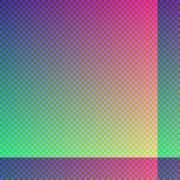

# example_coro_on_demand_texture

A virtual texture sampled from coroutines: each miss suspends the pixel, a host-side cache loads one page, and the scheduler resumes the waiters.

| | |
|---|---|
| Group | `coro` |
| Sources | `src/coro/on_demand_texture.cpp`, `src/common/headless.h` |
| Backends | dx, vk, cuda |
| Build | `xmake build example_coro_on_demand_texture` |
| Run | `example_coro_on_demand_texture dx --headless --frames 1 --capture coro_on_demand_texture.jpg` |



## Purpose

The smallest realistic use of an external stage as a data source. A 256×256
procedural image is cut into 64 virtual pages that live in host memory, while the
device holds eight physical slots and a page table. A pixel whose page is not
resident parks at a suspension point, the handler loads or evicts pages, and the
scheduler resumes exactly the parked pixels.

## Architecture

- **Virtual and physical layout.** `page_grid_size = 8` gives 64 virtual pages of
  32×32 texels, `physical_page_count = 8` slots in a `Buffer<float4>`
  `physical_cache` and a `Buffer<uint> page_table` storing `slot + 1` per page, so
  `0` means "not resident". `make_virtual_texture(256)` generates the content as a
  red/green `u`,`v` gradient with a 4-texel blue checkerboard, kept in host memory.
- **Coroutine and the outlined sampler.** `Callable<float4(uint2, Buffer<uint>,
  Buffer<float4>)> sample_texture` is `mark_noinline()` and contains
  `$while (table.read(page) == 0u) { $suspend("texture_miss",
  coro_annotation(...).fallback(reject).read("page", page)); }`, then the cache
  read. The coroutine calls it twice per pixel (the coordinate and the coordinate
  shifted by one page, wrapped) and writes `first * .25 + second * .75`; both call
  sites share one resume node, which the example asserts through
  `coroutine.graph().node_count() == 2`.
- **External stage.** `OnDemandTextureCache` claims the schema
  `luisa.coro.example.virtual-texture.request`. On prepare it uploads the empty
  page table and cache (before the entry kernel reads them) and compiles a
  collector kernel that copies each parked frame's `page` binding into a request
  buffer, offset by one. On dispatch it drains the requests, takes a free slot or
  evicts a page this batch does not need, copies that page's texels into the host
  cache, counts the load and re-uploads table and cache on `context.stream`.
- **Scheduler.** `WavefrontCoroScheduler<Image<float>, Buffer<uint>,
  Buffer<float4>>` with `thread_count = 256 * 256`, `gather_by_sorting`,
  `frame_buffer_compaction = false`, `execution_block_size = 256` and
  `report_stats`. Pixels whose page is still missing suspend again at the same
  point, so one scheduler dispatch absorbs all of the cache rounds.
- **Loop and output.** `--frames N` repeats
  `scheduler(output, page_table, physical_cache).dispatch(dimension, dimension)`
  (default 1) and the cache stays warm between passes. Every texel is then compared
  with the host-side blend of the virtual texture (max error ≤ 1e-6), a `Kernel2D`
  converts `FLOAT4` into `BYTE4`, and the image goes to `--capture` or to
  `coro_on_demand_texture.png`.

## Usage

```bash
example_coro_on_demand_texture dx                                   # writes coro_on_demand_texture.png
example_coro_on_demand_texture dx --headless --frames 1 --capture coro_on_demand_texture.jpg
example_coro_on_demand_texture cuda --test                          # 64x64 validation, no file
```

| Option | Meaning |
|---|---|
| `<backend>` | `dx`, `vk` or `cuda` |
| `--headless`, `--cli` | consumed for the shared convention; the example never opens a window, so the work is identical |
| `--frames N` | sampler passes through the scheduler (default 1); later passes reuse the pages already loaded |
| `--capture <file>`, `--screenshot <file>` | write the picture to exactly this file; `.png`, `.jpg`, `.bmp` and `.tga` follow the extension, and a capture implies the headless path |
| `--output-dir DIR` | directory for the default `coro_on_demand_texture.png` |
| `--test` | 64×64 image with 8×8 pages, no file; the page table is poisoned with `0xffffffff` first, so the run also proves that preparation initialises the cache before the coroutine reads it |

## Result

A 256×256 red-green gradient with a blue checkerboard, rebuilt from the pages the
coroutines asked for, plus the page-miss accounting (default file name shown):

```text
Wavefront continuation: index=1 token=1 name='texture_miss' dispatches=9 executed=360448 peak_queued=65536.
On-demand coroutine texture passed on 'vk': 256x256, 64 virtual pages / 8 physical pages, 9 handler rounds, 72 loads, 1 pass(es), max error 0.000000000, wrote 'coro_on_demand_texture.png' (headless, no window).
```

`72 loads` for 64 pages means a few pages were evicted and fetched again; the run
fails if fewer pages than the virtual texture were loaded or if any texel differs.

## See also

`example_coro_external_stage_neural_sdf` (two stages and a learned scene),
`example_coro_external_stage_debug` (a read-only stage), `example_procedural_tex`.
