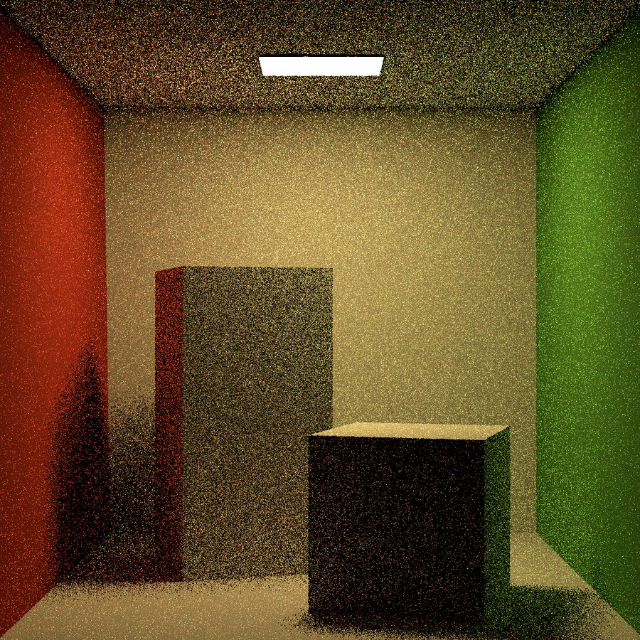

# example_coro_path_tracing

Cornell Box path tracing written as a LuisaCompute coroutine, with a switchable
dispatch shape and a selectable scheduler.

| | |
|---|---|
| Group | `rendering` |
| Sources | `src/rendering/coro_path_tracing.cpp` |
| Backends | dx, vk, cuda |
| Build | `xmake build example_coro_path_tracing` |
| Run | `example_coro_path_tracing dx --headless --spp 64 --capture coro_pt.jpg` |



## Purpose

The same Cornell Box estimator as `example_path_tracing` — next-event estimation,
multiple importance sampling, Russian roulette — but expressed as a coroutine, so a
bounce can be suspended at a `$suspend` point and resumed later by a scheduler
instead of running to completion inside one thread. That is the shape a
wavefront renderer needs, and the example makes the two ways of using it
switchable: one coroutine per pixel that loops over its samples, or one coroutine
per sample launched in a 3-D dispatch.

## Architecture

**Host setup.** The Cornell Box OBJ is parsed once with tinyobjloader into a shared
`Buffer<float3>`, one `Buffer<Triangle>` per shape, a `BindlessArray heap` binding
each triangle buffer at its shape index, an `Accel` over all meshes and a
`Constant` of eight albedos. Four images follow: `framebuffer` (`HALF4`),
`accum_image` (`FLOAT4`), `ldr_image` (`BYTE4`) and `seed_image` (`INT1`, seeded by
`make_sampler_shader` with `tea(p.x, p.y)`).

**The coroutine.** `Coroutine coro = [&](ImageFloat image, ImageUInt seed_image, AccelVar accel, UInt2 resolution)`.
`$suspend` points are placed at `per_spp`, `per_depth`, `before_tracing`,
`after_tracing`, `sample_light`, `sample_bsdf`, `rr` and `write_film`; the compiler
turns them into subroutines whose live state becomes frame fields, and the program
prints the resulting subroutine and graph counts plus
`dump_coro_frame_rw(coro)`. The body itself mirrors the plain path tracer:
`accel.intersect` for the primary ray and `accel.intersect_any` for the shadow
ray, `reorder_shader_execution()`, the triangle through `heap->buffer<Triangle>`,
`offset_ray_origin` before both rays, `cosine_sample_hemisphere` and
`balanced_heuristic` for MIS, and Russian roulette on `beta`.

**Dispatch shape.** `--batch-dispatch` (the default) runs one coroutine per pixel
that consumes `spp_per_coroutine` samples, `.dispatch(resolution)`.
`--sample-dispatch` sets `spp_per_coroutine` to 1 and dispatches
`.dispatch(resolution.x, resolution.y, samples_per_pass)` — one coroutine per
sample. `samples_per_pass` is 64 on the usual backends and 1 on `metal`/`fallback`.
`--compare` forces batch dispatch, because per-pixel accumulation must not race.

| Scheduler | Implementation |
|---|---|
| `state_machine` (default) | `StateMachineCoroScheduler` |
| `wavefront` | `WavefrontCoroScheduler` with `WavefrontCoroSchedulerConfig{.thread_count = 4_M, .global_memory_soa = true, .gather_by_sorting = false}` |
| `persistent` | `PersistentThreadsCoroScheduler` with `PersistentThreadsCoroSchedulerConfig{.block_size = 32u}` |

**Render loop.** Offline renders `passes = ceil(total_spp / samples_per_pass)`
passes, synchronising and timing each one, then runs `hdr2ldr_shader` and copies the
LDR image back for `image_io::write_image` — `coro_path_tracing.png` by default, or
the `--capture` path. The windowed path creates a `Window` titled
`Coroutine Path Tracing` plus a `Swapchain`, accumulates without a sample limit and
writes the same file when the window closes.

## Usage

```bash
example_coro_path_tracing dx                                        # window
example_coro_path_tracing dx --headless --spp 64 --capture coro_pt.jpg
example_coro_path_tracing cuda --headless --spp 256 --scheduler wavefront
example_coro_path_tracing vk --headless --spp 32 --resolution 512 --sample-dispatch
```

| Option | Meaning |
|---|---|
| `--headless` / `--offline` | Render without a window and exit |
| `--spp N` | Total samples per pixel (default 1024) |
| `--resolution N` | Square image edge in pixels (default 1024) |
| `--sample-dispatch` / `--batch-dispatch` | One coroutine per sample, or one per pixel |
| `--scheduler <kind>` | `state_machine` (default), `wavefront` or `persistent` |
| `--capture <file.png\|file.jpg>` | Destination file; the extension picks the container |
| `--output-dir DIR` | Directory for the default `coro_path_tracing.png` |
| `--compare <ref.png>` / `-c <ref.png>` | PSNR check; also forces batch dispatch |

## Result

The Cornell Box — warm ceiling light, white floor and back wall, green and red side
walls, two boxes with soft shadows — plus a per-pass timing line and a final
summary that names the dispatch shape and the file written:

```text
Coroutine dispatch shape: per-pixel batched coroutine (64 SPP/pass, 64 SPP/coroutine)
Headless coroutine path tracing finished: 64 spp, wrote 'coro_pt.jpg'.
```

At the same `--spp` the result is the same image as `example_path_tracing`, up to
floating-point ordering: the coroutine form changes how the work is scheduled, not
what is computed.

## See also

`example_coro_path_tracing_wavefront` for the same source built with the 3-D sample
dispatch as its default, `example_coro_sdf_renderer` for a coroutine renderer on a
distance-field scene.
