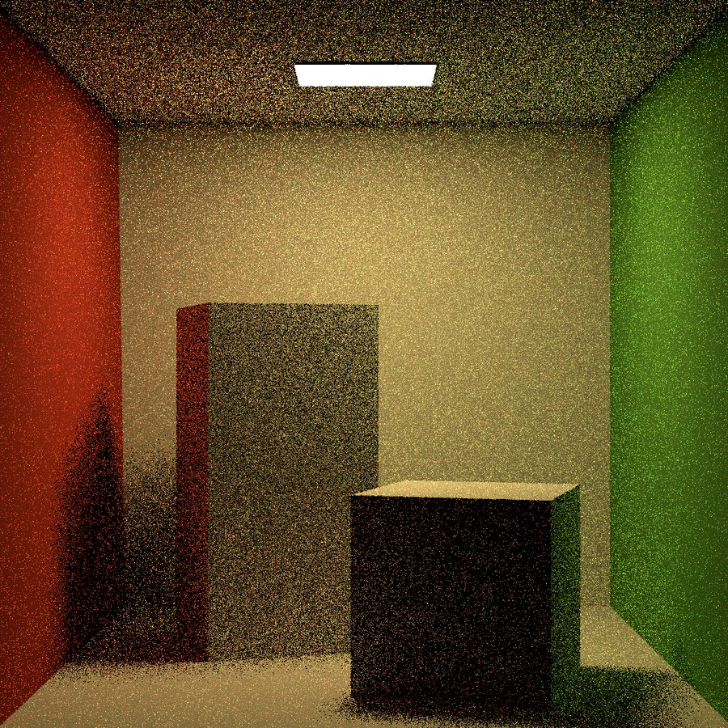

# example_coro_path_tracing_wavefront

The coroutine path tracer built with the wavefront dispatch shape as its default:
one coroutine per sample, launched as a 3-D dispatch.

| | |
|---|---|
| Group | `rendering` |
| Sources | `src/rendering/coro_path_tracing.cpp` |
| Backends | dx, vk, cuda |
| Build | `xmake build example_coro_path_tracing_wavefront` |
| Run | `example_coro_path_tracing_wavefront dx --headless --spp 64 --capture coro_wavefront.jpg` |



## Purpose

This target is built from the same translation unit as `example_coro_path_tracing`,
with one compile definition:

```text
LUISA_CORO_PATH_TRACING_SAMPLE_DISPATCH_DEFAULT=1
```

That constant only sets the initial value of the `sample_dispatch` flag, so the
binary starts in the "old wavefront-style 3-D sample dispatch" mode instead of the
"per-pixel batched coroutine" mode. It exists so the wavefront shape can be run —
and tested — without remembering a command-line switch, and so the two shapes can
be compared on equal terms from the same source.

## Architecture

**What changes.** With `sample_dispatch` true, `spp_per_coroutine` becomes `1` and
the scheduler is dispatched as
`(*scheduler)(framebuffer, seed_image, accel, resolution).dispatch(resolution.x, resolution.y, samples_per_pass)`:
a 3-D grid where the third dimension is the sample index, one coroutine instance per
sample. With the flag false the dispatch is `.dispatch(resolution)` and each
coroutine loops over `spp_per_coroutine` samples itself. `samples_per_pass` is 64 on
`dx`, `vk` and `cuda`, and 1 on `metal`/`fallback`.

**What does not change.** Everything else is shared verbatim: the Cornell Box loaded
from `obj_string` through tinyobjloader, the `Accel`, the `BindlessArray heap`, the
eight-albedo `Constant`, the `Coroutine` with its `$suspend` points at `per_spp`,
`per_depth`, `before_tracing`, `after_tracing`, `sample_light`, `sample_bsdf`, `rr`
and `write_film`, the three schedulers, `accumulate_shader`, `clear_shader`,
`hdr2ldr_shader` and the 1024² `HALF4` framebuffer. Because they share a source
file, the two targets also share their results: at the same `--spp` the captured
images of `example_coro_path_tracing` and this target are identical, which is the
point of the pair — the dispatch shape decides how the coroutines are scheduled,
not what any of them computes.

**Overriding the default.** `--batch-dispatch` switches back to the per-pixel shape
at run time, so a single binary can reproduce either mode; `--sample-dispatch` just
re-states the default. `--compare` forces batch dispatch, since the comparison
assumes race-free per-pixel accumulation.

The dispatch shape and the scheduler are separate choices: `--scheduler wavefront`
picks a scheduling strategy, while "wavefront-style dispatch" here names the 3-D
grid the scheduler is launched over. Both can be combined freely.

## Usage

```bash
example_coro_path_tracing_wavefront dx                              # window
example_coro_path_tracing_wavefront dx --headless --spp 64 --capture coro_wavefront.jpg
example_coro_path_tracing_wavefront cuda --headless --spp 256 --scheduler wavefront
example_coro_path_tracing_wavefront vk --headless --spp 32 --batch-dispatch
```

| Option | Meaning |
|---|---|
| `--headless` / `--offline` | Render without a window and exit |
| `--spp N` | Total samples per pixel (default 1024) |
| `--resolution N` | Square image edge in pixels (default 1024) |
| `--sample-dispatch` / `--batch-dispatch` | Force the 3-D sample dispatch (default here) or the per-pixel batched one |
| `--scheduler <kind>` | `state_machine` (default), `wavefront` or `persistent` |
| `--capture <file.png\|file.jpg>` | Destination file; the extension picks the container |
| `--output-dir DIR` | Directory for the default `coro_path_tracing.png` |
| `--compare <ref.png>` / `-c <ref.png>` | PSNR check; also forces batch dispatch |

## Result

The Cornell Box again, with the console confirming which shape was compiled in:

```text
Coroutine dispatch shape: old wavefront-style 3D sample dispatch (64 SPP/pass, 1 SPP/coroutine)
Headless coroutine path tracing finished: 64 spp, wrote 'coro_wavefront.jpg'.
```

Because every sample becomes its own coroutine, this shape has many more live
coroutines per frame than the batched one; it is the mode to try when comparing
schedulers, since the scheduling differences show up most clearly with a large
number of short coroutines.

## See also

`example_coro_path_tracing` for the same source with the batched default,
`example_coro_sdf_renderer` for a coroutine renderer that suspends inside its ray
march.
