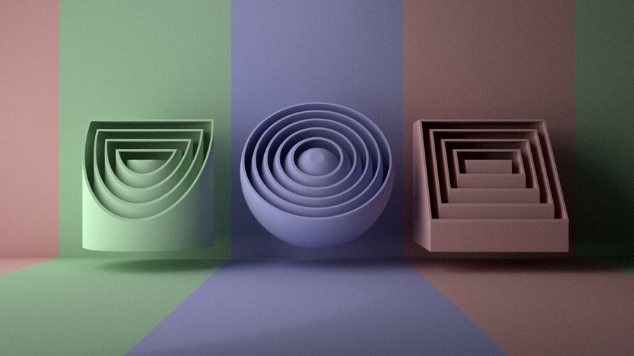

# example_coro_sdf_renderer

The SDF path tracer written as a LuisaCompute coroutine: the per-pixel path is
split into resumable subroutines and executed by a selectable scheduler.

| | |
|---|---|
| Group | `rendering` |
| Sources | `src/rendering/coro_sdf_renderer.cpp` |
| Backends | dx, vk, cuda |
| Build | `xmake build example_coro_sdf_renderer` |
| Run | `example_coro_sdf_renderer dx --headless --spp 256 --capture coro_sdf.jpg` |



## Purpose

A coroutine is a function that can suspend itself and be resumed later with all of
its local state intact. This example writes a path tracer that way: the same scene
as `example_sdf_renderer`, but with `$suspend` points wherever the hardware would
otherwise have to keep a long-lived thread. That turns "one thread walks one path"
into "one scheduler alternates between many paths", which is what the `lc-coro`
module is for. A reader learns how to declare a `Coroutine`, how suspension points
become a graph of subroutines, and how the three schedulers change the way that
graph is executed.

## Architecture

**The coroutine.** `Coroutine coro = [&](ImageUInt seed_image, ImageFloat accum_image, UInt frame_index)`
contains the whole renderer. `$suspend("setup")` follows the seed/clear block;
inside the march, every iteration ends with `$suspend("ray_march")`; further points
sit at `next_hit`, at `bounce` and at the final `write`. The compiler analyses those
points and produces a graph plus a frame: the program prints
`coro.subroutine_count()`, `coro.graph().node_count()`, the frame field count and
payload size, and `dump_coro_frame_rw(coro)` lists, per subroutine, the fields it
reads, the fields it writes and every edge with the fields it loads and stores.
Those lines are the best way to see which variables actually have to travel across
a suspension.

**Schedulers.** `--scheduler` selects the kind (`parse_coro_scheduler_arg` in
`common/coro_scheduler_options.h`); each one implements the same
`CoroScheduler<Image<uint>, Image<float>, uint>` interface over the coroutine:

| Value | Implementation | Character |
|---|---|---|
| `state_machine` | `StateMachineCoroScheduler` | Default; each thread advances its own coroutine through an explicit state per suspension point |
| `wavefront` | `WavefrontCoroScheduler` with `WavefrontCoroSchedulerConfig` | One queue per continuation: threads parked at the same suspension point are executed together as a wavefront |
| `persistent` | `PersistentThreadsCoroScheduler` with `PersistentThreadsCoroSchedulerConfig` | A resident thread pool (`thread_count`, `block_size`) drains workgroup-local queues in place |

`(*scheduler)(seed_image, accum_image, frame).dispatch(width, height)` looks like a
kernel dispatch but may expand into several stream submissions, so scheduler calls
are never nested inside a `CommandList` here.

**The scene.** Unchanged from the plain version: `sdf`, `make_nested`,
`intersect_light`, `out_dir` and `rand` build the rippled sphere/box/cylinder
scene, `sdf_normal` uses forward differences, and the loop keeps
`throughput`, `hit_light` and the accumulated colour.

**Output.** 1280×720 accumulation in `accum_image` (`FLOAT4`) with the running
mean `lerp(old, value, 1 / (frame_index + 1))`; `hdr2ldr_kernel` divides by the
sample weight, applies `linear_to_srgb` and a 2.0 scale into a `BYTE4` image which
is copied back and written as `coro_sdf.png` or the `--capture` path.
`--spp` is the total sample count (default 1024); the loop submits them in batches
of 64, or one at a time while a window is open.

**Numeric reference.** `--out_ref write <file>` dumps the raw `FLOAT4`
accumulation as floats; `--out_ref read <file>` compares against such a dump with
an absolute tolerance of 1e-5 and a relative tolerance of 1e-4, failing on the
first pixel outside it. That is the practical way to check that a scheduler change
did not alter the result, because it bypasses tonemapping and 8-bit quantisation.

## Usage

```bash
example_coro_sdf_renderer dx                                     # window
example_coro_sdf_renderer dx --headless --spp 256 --capture coro_sdf.jpg
example_coro_sdf_renderer cuda --headless --spp 64 --scheduler wavefront
example_coro_sdf_renderer vk --headless --spp 16 --out_ref read sdf.f32
```

| Option | Meaning |
|---|---|
| `--headless` / `--offline` | Render without a window and exit |
| `--spp N` | Total samples per pixel (default 1024) |
| `--scheduler <kind>` | `state_machine` (default), `wavefront` or `persistent` |
| `--capture <file.png\|file.jpg>` | Destination file; the extension picks the container |
| `--output-dir DIR` | Directory for the default `coro_sdf.png` |
| `--compare <ref.png>` / `-c <ref.png>` | PSNR check on the tonemapped image |
| `--out_ref write\|read <file>` | Dump or verify the raw accumulation buffer |

How long the run lasts is decided by `--spp`, not by `--frames`: the shared option
parser accepts `--frames`, but this example counts samples.

## Result

The same interior as `example_sdf_renderer` — sphere, box and cylinder on a plane
against a wall, lit from the left — plus a console report of the coroutine shape
the compiler chose and the scheduler that ran it:

```text
CoroScheduler: state_machine
Headless coroutine SDF render finished: 256 spp, wrote 'coro_sdf.jpg'.
```

## See also

`example_sdf_renderer` and `example_sdf_renderer_xir2ast` for the same scene
without coroutines, `example_coro_path_tracing` for a coroutine renderer that also
switches its dispatch shape.
