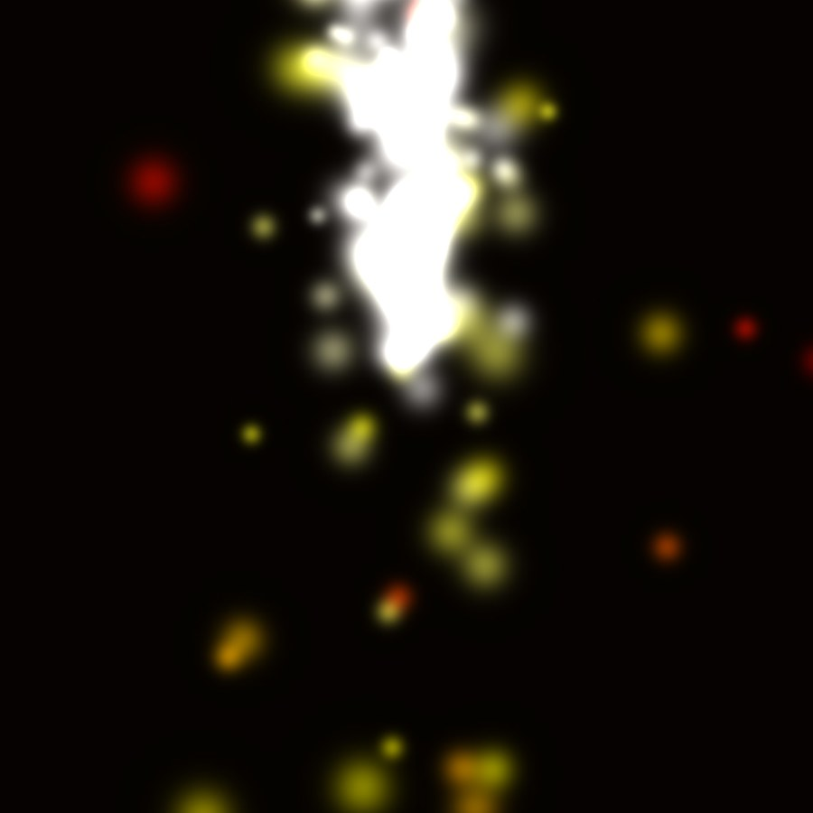

# example_fire_simulation

A 65 536-particle fire and smoke system: particles are integrated on the GPU, splatted with a temperature colour ramp, and verified particle by particle in the offline path.

| | |
|---|---|
| Group | `simulation` |
| Sources | `src/simulation/fire_simulation.cpp` |
| Backends | dx, vk, cuda |
| Build | `xmake build example_fire_simulation` |
| Run | `example_fire_simulation dx --headless --capture fire.jpg` |



## Purpose

The example shows how much a plain particle system can do with two kernels and no
acceleration structure: an update kernel integrates every particle, a render kernel
splats them into a 1024x1024 image with additive blending and a
black -> red -> orange -> yellow -> white temperature ramp. It also demonstrates
user structs in device code (`FireParticle` with `LUISA_STRUCT`) and a birth/death
cycle that never needs a host round trip. The offline path doubles as a numerical
check: the first integration step of four particles is compared against the analytic
expectation, and their final state must stay inside plausible bounds.

## Architecture

- **Host side.** A `FireParticle` (position, lifetime, velocity, temperature, size,
  padding) is registered with `LUISA_STRUCT` and allocated as a single
  `Buffer<FireParticle>` of 65 536 elements. The initial cloud is drawn from
  `std::mt19937` and uploaded once; the offline run seeds the generator with 42 so two
  runs start from the same state. `display` is a `PixelStorage::BYTE4` image of
  1024x1024, or the swapchain back-buffer storage when a window is open.
- **`update_kernel`** (1D, `set_block_size(256)`, dispatched over 65 536 particles)
  applies a constant gravity of -2.0, adds sine-wave turbulence plus an optional wind
  term, integrates the position, cools the particle by `dt * 0.3` and decrements its
  lifetime with `dt = 0.016`. Dead particles respawn at the source from a hash of the
  particle index and the current time, so the cycle is entirely on the device.
- **`render_kernel`** (2D, 16x16 block, dispatched over 1024x1024) keeps a dark
  background and, for every pixel, loops over a 1/256 subset of the particles
  (`render_particle_stride`), projects each one to screen space, and accumulates
  `exp(-d^2 / r^2)`-weighted colour. Drawing all 65 536 particles in every pixel is
  prohibitively expensive, so 256 samples stand in for the full set; the offline
  probes deliberately cover both a sampled index and a skipped one.
- **Offline path.** 200 frames of update+render; the state of particles 0, 1, 256 and
  257 is captured after the first frame and again at the end, validated by
  `validate_offline_particle`, then the image is copied to host memory and written.

## Usage

```bash
# interactive (needs a window and the gui module)
example_fire_simulation dx

# offline: bounded loop, one image out
example_fire_simulation dx --headless --capture fire.jpg
example_fire_simulation dx --offline --output-dir out
```

| Option | Meaning |
|---|---|
| `--headless`, `--offline` | no window, no swapchain; run the bounded loop and write the image |
| `--capture <file>` | write the result to exactly this file (`.png`, `.jpg`/`.jpeg`, `.bmp`, `.tga` select the container, anything else falls back to PNG); implies the offline path |
| `--output-dir <dir>` | where the default `test_fire_simulation.png` is written (default: the working directory) |
| `--frames N` | parsed by the shared option parser; this example's offline loop is fixed at 200 frames |
| `-c`, `--compare <ref.png>` | compare the result against a reference image and exit non-zero when it does not match |

In the window, `SPACE` toggles the wind, `R` re-seeds the particles and `ESC` quits.

## Result

A bright, turbulent plume on a near-black background. The offline run reports the
state validation and the file it wrote:

```text
Offline fire state validation: PASSED (rendered indices 0, 256; non-rendered indices 1, 257).
Headless fire simulation finished: 200 frame(s), wrote 'fire.jpg'.
```

## See also

`example_game_of_life` (a neighbour stencil instead of particles),
`example_nbody_simulation` (gravity between particles), `example_wave_equation`.
