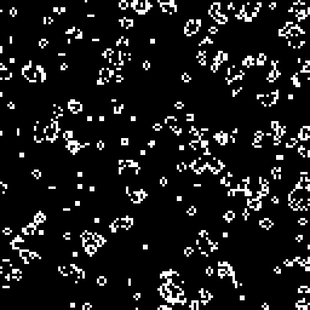

# example_game_of_life

Conway's Game of Life on a 128x128 toroidal grid, one cell per texel, run with a ping-pong image pair.

| | |
|---|---|
| Group | `simulation` |
| Sources | `src/simulation/game_of_life.cpp` |
| Backends | dx, vk, cuda |
| Build | `xmake build example_game_of_life` |
| Run | `example_game_of_life dx --headless --capture game_of_life.jpg` |



## Purpose

The smallest useful cellular automaton on the GPU, and a clean illustration of the
double-buffering pattern every stencil code needs: a kernel may not read and write
the same image, so two images are swapped after each generation. It also shows how a
low-resolution simulation is scaled up for display in a second, trivial dispatch.

## Architecture

- **Host side.** Two `Image<uint>` of 128x128 with `PixelStorage::BYTE4` are held in
  an `ImagePair` (`prev`, `curr`, plus a `swap()` that exchanges them). The grid is
  initialised on the host with a 25% chance of being alive per cell and uploaded with
  `copy_from`; the offline run draws from `std::mt19937` seeded with 42, so two
  offline runs start from the same board. `display` is a 512x512
  `PixelStorage::BYTE4` image (4x4 pixels per cell), or the swapchain back buffer
  when a window is open.
- **`read_state`** is a small `Callable` that turns a texel into a boolean: a cell is
  alive when its red channel is 255.
- **Game-of-life kernel** (2D, 16x16 block, dispatched over 128x128) reads the state of
  the cell and its eight neighbours, resolves each neighbour with
  `make_uint2(q) % size` so the board wraps at the edges, and applies Conway's rules
  in one expression: a live cell survives with 2 or 3 neighbours, a dead cell is born
  with exactly 3. The result is written as 255 or 0 into `curr`.
- **`display_kernel`** (2D, 16x16 block, dispatched over 512x512) samples `curr` at
  `uv / 4` and writes `value / 255` as a float4, which upsamples each cell to a 4x4
  block and converts the byte grid to colour.
- **Offline path.** 100 generations of update+display, then the display image is
  copied to host memory and written out; a swap after every generation keeps `prev`
  as the newest board.

## Usage

```bash
# interactive (needs a window and the gui module)
example_game_of_life dx

# offline: 100 generations, one image out
example_game_of_life dx --headless --capture game_of_life.jpg
example_game_of_life dx --offline --output-dir out
```

| Option | Meaning |
|---|---|
| `--headless`, `--offline` | no window, no swapchain; run the bounded loop and write the image |
| `--capture <file>` | write the result to exactly this file (`.png`, `.jpg`/`.jpeg`, `.bmp`, `.tga` select the container, anything else falls back to PNG); implies the offline path |
| `--output-dir <dir>` | where the default `test_game_of_life.png` is written (default: the working directory) |
| `--frames N` | parsed by the shared option parser; this example's offline loop is fixed at 100 generations |
| `-c`, `--compare <ref.png>` | compare the result against a reference image and exit non-zero when it does not match |

In the window, `SPACE` starts and pauses the simulation, `R` resets the board and
`ESC` quits.

## Result

White live cells on a black background, evolved for 100 generations, so the initial
noise has already condensed into the familiar still lifes and oscillators:

```text
Headless game of life finished: 100 generation(s), wrote 'game_of_life.jpg'.
```

## See also

`example_fire_simulation` (particles with a birth/death cycle),
`example_wave_equation` (a three-buffer stencil instead of a two-buffer one).
