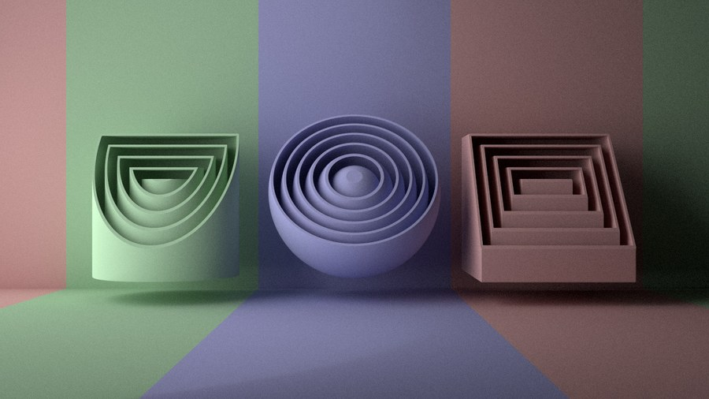

# example_image_process

An image-processing pipeline driven from an ImGui window: an ordered list of per-pixel operators applied in one compute dispatch, plus a full headless self test.

| | |
|---|---|
| Group | `gui` |
| Sources | `src/gui/image_process/main.cpp`, `src/gui/image_process/image_process.cpp`, `src/gui/image_process/image_process.h`, `src/gui/image_process/headless_test.cpp` |
| Backends | dx, vk, cuda |
| Build | `xmake build example_image_process` |
| Run | `example_image_process dx --headless --image asset/sdf_renderer.png --capture image_process.jpg` |



## Purpose

A complete application rather than a shader demo: load a picture, stack `Add`, `Sub`,
`Mul`, `Div`, `Min`, `Max`, `Pow` and `Abs` operators with a colour argument each, watch
the result and its alpha channel, then save it. The operator list is data, not generated
code -- the kernel walks a `uint` buffer at runtime -- and the same path is a self test.

## Architecture

- **Command line.** `main` runs `luisa::gallery::headless::parse` for the shared flags and
  its own `parse_options` for the rest, then folds them together (`--capture` becomes
  `--save-to`). `--headless` alone runs the test suite, `--headless --image` one picture.
- **`ImageProcessPipeline`** owns the shader and the device images: a
  `Buffer<uint32_t>` of `max_operator_count * operator_stride` slots (256 operators,
  two uints each) and three `PixelStorage::FLOAT4` images for input, result and the
  grayscale alpha view. `load()` re-creates them and uploads RGBA floats,
  `set_operators()` encodes/upload/dispatches, `readback_result()` copies back
  synchronously. Eight encoded uploads stay alive, because a backend may read the
  staging pointer when the command is recorded rather than when it is submitted.
- **`make_image_process_shader`** builds a `Shader<2, ...>`: `set_block_size(16, 16)`, a
  `$for` over the runtime `operator_count`, a `$switch` on the decoded op code with the
  RGBA argument unpacked from four bytes, then two writes -- the processed pixel and
  `value.w` for the alpha pane. Division uses `copysign(max(|arg|, 1e-6), arg)` so a
  zero argument stays well defined. `apply_operators_cpu` mirrors the switch on the host
  and is the reference the tests compare the kernel against.
- **`ImageProcessApp`** is the interactive shell: two panes that follow the window size,
  a floating "Settings" window with load/save buttons (native Windows file dialogs, hence
  the `comdlg32` link dependency) and the operator list with append, insert, remove and a
  colour picker per entry. It re-dispatches only when something became dirty.
- **`headless_test.cpp`** runs five groups without a window: operator encoding and
  decoding, GPU-versus-CPU chains (identity, single add, abs/sub, division by zero, a
  long random chain, 256 operators), a round trip through every writable format,
  load-only formats (PNM, PSD, GIF) and edge cases such as empty lists, 1x1 images and
  partial thread blocks. The exit code is the number of failed checks.

## Usage

```bash
# interactive (needs a window and the gui module)
example_image_process dx --image asset/sdf_renderer.png
example_image_process dx --operators "mul 0.9 0.9 0.9 1; add 0.1 0 0 0"
# headless: process one image offscreen, or run the self test without --image
example_image_process dx --headless --image asset/sdf_renderer.png --capture image_process.jpg
example_image_process dx --headless --output-dir image_process_output
```

| Option | Meaning |
|---|---|
| `--headless`, `--cli` | no window; run the self test, or one offscreen image when `--image` is given |
| `--image <file>` | image to load at startup (skips the file dialog); any stb_image format is accepted |
| `--operators <spec>` | initial operator list, `"<name> [r g b a]; ..."`, e.g. `"mul 0.9 0.9 0.9 1; add 0.1 0 0 0"` |
| `--save-to <file>`, `--capture <file>` | save the processed image to this path (the GUI applies `--save-to` before exiting); `.png`, `.jpg`/`.jpeg`, `.bmp`, `.tga` and `.hdr` select the container |
| `--output-dir <dir>` | output directory (default `image_process_output`); the offscreen image becomes `gui_image_process.png` |
| `--frames N` | GUI: close the window after N frames. Headless: repeat the dispatch N times (default 1) |

## Result

In the window, the processed RGB image on the left and the alpha channel in grayscale
on the right, with the operator list in the Settings panel. Without `--image` the headless
run instead prints one line per format and a summary:

```text
Running headless image process tests (output dir: 'image_process_output')
[test:image-formats] .png ok (load 0.000e+00, gpu 0.000e+00, save 0.000e+00)
[test:image-formats] .hdr ok ...
Headless image process tests: 65 checks, 0 failures
```

`--image` replaces the suite with one offscreen run, which reports
`Headless image process: 'sdf_renderer.png' 1280x720, 2 operator(s), 1 frame(s)`.

## See also

`example_procedural_tex` (generates pictures this example can recolour),
`example_imgui` (the ImGui integration in isolation), `example_image_processing`.
