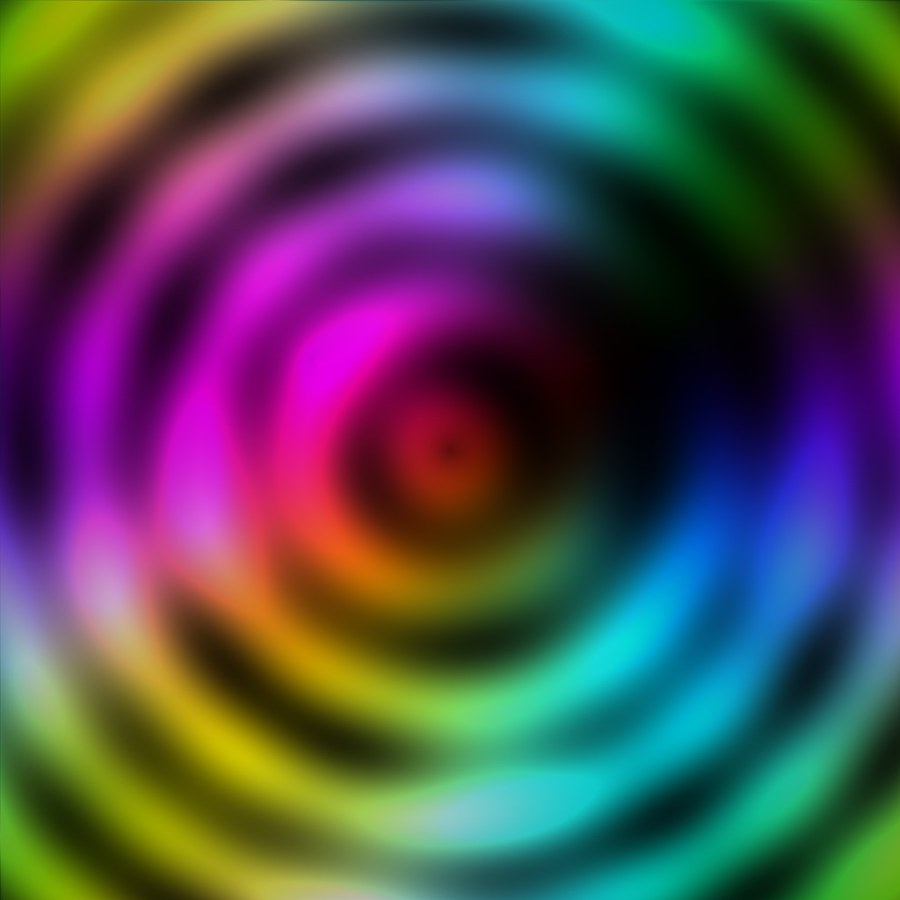

# example_image_processing

A five-kernel image pipeline — procedural pattern, separable Gaussian blur, Sobel edges, composite — with a window and a headless image writer.

| | |
|---|---|
| Group | `compute` |
| Sources | `src/compute/image_processing.cpp`, `src/common/reference_compare.h`, `src/common/image_io.h` |
| Backends | dx, vk, cuda |
| Build | `xmake build example_image_processing` |
| Run | `example_image_processing dx --headless --capture filtered.jpg` |



## Purpose

The example is a small post-processing pipeline: five kernels over 1024×1024 images, four
of them per-iteration passes, each a `Kernel2D`, with intermediate results kept in device
images. It shows how to chain passes on one stream, why a Gaussian is split into two
separable passes, how a `FLOAT4` working image becomes a `BYTE4` display image, and how an
example with a window and an offline path shares one core.

## Architecture

- **Images.** Four `Image<float>` working images at `PixelStorage::FLOAT4` (`source_image`,
  `temp_image`, `blurred_image`, `edge_image`) plus `display`: a `BYTE4` image in the
  offline path, or the swapchain's storage in the window path.
- **Kernels** — all `Kernel2D` with `set_block_size(16, 16, 1)` and
  `.dispatch(width, height)`:
  - `generate_pattern` synthesises the "photo": a checkerboard, concentric circles and a
    diagonal gradient combined with three sines, two eye blobs and a mouth, tinted by a
    three-phase sine ramp. No asset is loaded, so the example needs no data.
  - `gaussian_blur_h` / `gaussian_blur_v` apply a normalized 9-tap kernel (σ = 2) along
    one axis each, clamping coordinates at the border. Two passes instead of one 9 × 9
    convolution: 18 taps instead of 81 per pixel.
  - `sobel_edge` evaluates the 3 × 3 Sobel operators on the luminance and writes the
    gradient magnitude into `R` and the gradient angle into `G`.
  - `composite` does the presentation work: an unsharp mask (`original + (original -
    blurred) * 1.5`), a cyan edge overlay whose weight is the `edge_intensity`
    uniform, and a radial vignette.
- **Loop.** In the window path the blur and Sobel passes run once and only `composite`
  is re-dispatched each frame, with `edge_intensity = (sin(t) + 1) / 2` pulsing and
  `swap_chain->present(display)` showing the result. In the offline path the whole
  chain runs `--iterations` times (default 1), timed by a `Clock`.
- **Readback.** `display.copy_to(host_image)` then
  `luisa::gallery::image_io::write_image(opts.image_path("test_image_processing.png"), …)`
  — one call, container chosen by the file extension.
- **Options and compare.** The file uses `luisa::ref::ExampleOptions`, so `--headless`
  (alias `--offline`), `--frames`/`--iterations`, `--output-dir`, `--capture`/
  `--screenshot` and `--compare`/`-c` come from the shared parser; `--compare` re-reads
  the reference and returns non-zero when the result differs.
- **Files.** `image_processing.cpp` owns everything; `reference_compare.h` provides the
  option parser and the reference comparison, `image_io.h` the writer.

## Usage

```bash
example_image_processing dx                                       # window, animated
example_image_processing dx --headless --capture filtered.jpg
example_image_processing dx --headless --frames 8 --output-dir out
example_image_processing dx --headless --compare reference.png
```

| Option | Meaning |
|---|---|
| `<backend>` | `dx`, `vk` or `cuda`; the window path needs the gui module and a graphics backend |
| `--headless`, `--offline` | no window, no swapchain: run the pipeline, write the picture, exit. Required when the build has no gui module |
| `--capture <file>`, `--screenshot <file>` | write the picture to exactly this file; `.png`, `.jpg`, `.bmp` and `.tga` follow the extension; implies the headless path |
| `--frames N`, `--iterations N` | how many times the pipeline runs; more iterations only change the timing report, the image is deterministic |
| `--output-dir DIR` | directory for the default output `test_image_processing.png` |
| `--compare <file>`, `-c` | compare against a reference image, exit non-zero when it differs |

## Result

The captured image is the composite: the sharpened procedural pattern with cyan Sobel
edges laid over it and a vignette darkening the corners. Example console output:

```text
[info] Image Processing Pipeline Demo
[info] Shows: Gaussian Blur -> Sobel Edge Detection -> Compositing
[info] Offline image pipeline: 1 iterations in 5.645 ms (5.645 ms/iteration).
[info] Headless image processing finished: 1 iteration(s), wrote 'filtered.jpg'.
[info] image_processing: success (headless=true, 1 iteration(s)).
```

## See also

`example_image_process` (a GUI image viewer/processor built on the same idea),
`example_bindless_mip` (image levels and sampling without a window).
