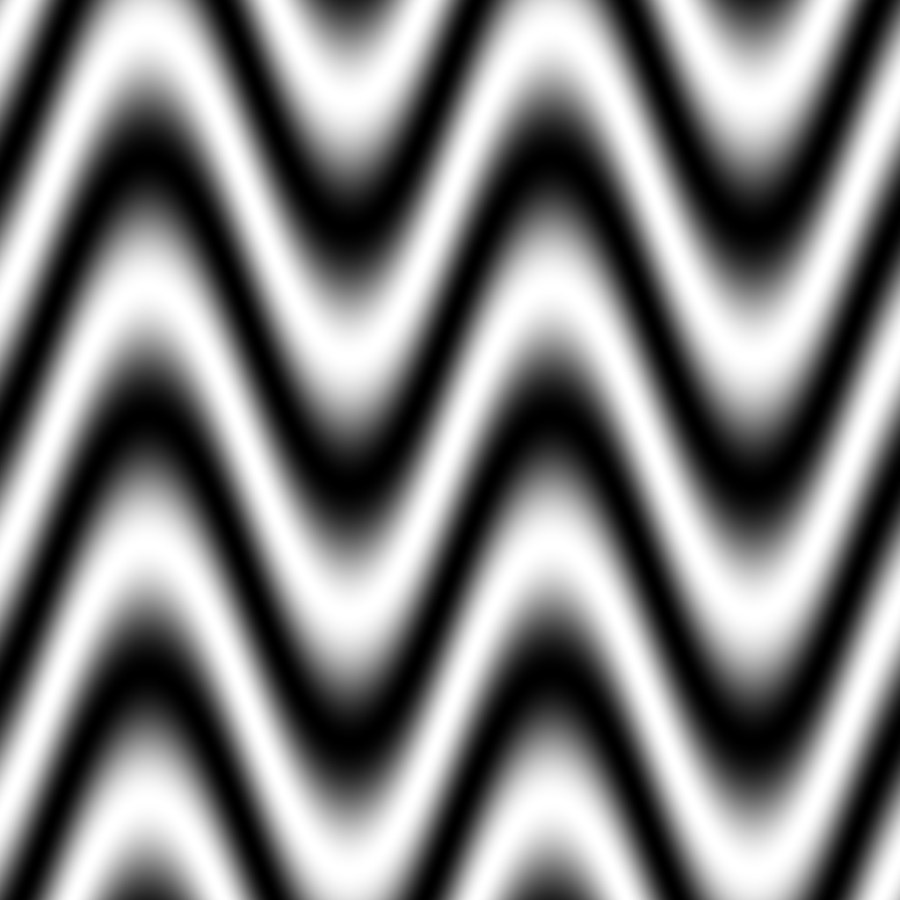

# example_imgui

Dear ImGui hosted on a LuisaCompute swapchain: a compute shader paints the background and ImGui draws its widgets on top.

| | |
|---|---|
| Group | `gui` |
| Sources | `src/gui/imgui.cpp` |
| Backends | dx, vk, cuda |
| Build | `xmake build example_imgui` |
| Run | `example_imgui dx --headless --frames 8 --capture imgui.jpg` |



## Purpose

The entry point to every interactive example in the gallery. It shows the minimum
amount of code needed to get windows, textures and widgets on the GPU: one
`ImGuiWindow` that owns the platform window, the swapchain and the ImGui context, one
compute shader that fills the framebuffer, and calls such as `register_texture` and
`ImGui::Image` that display a device image inside the UI. The same file also has a
window-less path, so the shader can be checked in CI.

## Architecture

- **Host side.** A 1024x1024 `PixelStorage::FLOAT4` image (`demo_image`) is created
  once and filled by the shader; the stream is created with `StreamTag::GRAPHICS`
  when a window is open and with `StreamTag::COMPUTE` in headless mode, because no
  swapchain will be presented.
- **`draw`** is a 2D shader (`device.compile<2>`) dispatched over the full resolution.
  It builds `uv` from `dispatch_id().xy()`, evaluates three cosine waves whose
  frequencies come from `Constant{pi, e, sqrt(2)}`, and writes an opaque float4.
  Being a compute shader, it needs no vertex buffer, no pipeline state and no
  render pass.
- **`ImGuiWindow window{device, stream, "Display", {.vsync = false}}`** creates the
  native window, the swapchain and the ImGui backend in one object.
  `window.with_context(...)` runs a block with the example's ImGui context current,
  which is where the style is switched to dark; the same mechanism allows several
  independent ImGui contexts in one process.
- **Per-frame sequence.** `window.prepare_frame()` starts a frame, the background
  shader is dispatched into `window.framebuffer()`, the widget code runs, and
  `window.render_frame()` submits everything and presents. The framebuffer may be
  invalid -- for example while the window is minimised -- so it is tested before use.
- **Textures and input.** `window.register_texture(demo_image, Sampler::linear_linear_zero())`
  returns an ImGui texture id; registering the same image twice is safe and returns
  the same id. The "Picture" window draws it with `ImGui::Image` and uses the mouse
  wheel to zoom between 0.1x and 10x, next to the stock ImGui demo window and a small
  "Hello, world!" panel with a slider, a colour picker and a counter.
- **Headless path.** With `--headless` no window, no swapchain and no ImGui context
  exist: the shader is dispatched `frames` times into a `PixelStorage::BYTE4` image,
  copied to host memory and written as `gui_imgui.png` (or to `--capture`).

## Usage

```bash
# interactive (needs a window and the gui module)
example_imgui dx

# headless: eight dispatches, one image out
example_imgui dx --headless --frames 8 --capture imgui.jpg
example_imgui dx --headless --output-dir out
```

| Option | Meaning |
|---|---|
| `--headless`, `--cli` | no window, no swapchain, no ImGui; run the compute work and write an image |
| `--frames N` | how many times the background shader is dispatched (default: 1) |
| `--capture <file>` | write the image to exactly this file (`.png`, `.jpg`/`.jpeg`, `.bmp`, `.tga` select the container, anything else falls back to PNG); implies the headless path |
| `--output-dir <dir>` | where the default `gui_imgui.png` goes (default: the working directory) |

## Result

The interactive window shows the animated colour field with the ImGui panels floating
above it. The headless run reports the frame count and timing:

```text
Headless imgui: 8 frame(s) of the background shader ..., wrote 'imgui.jpg'.
```

## See also

`example_swapchain` and `example_swapchain_static` (presenting to a window without
ImGui), `example_image_process` and `example_procedural_tex` (full ImGui
applications).
