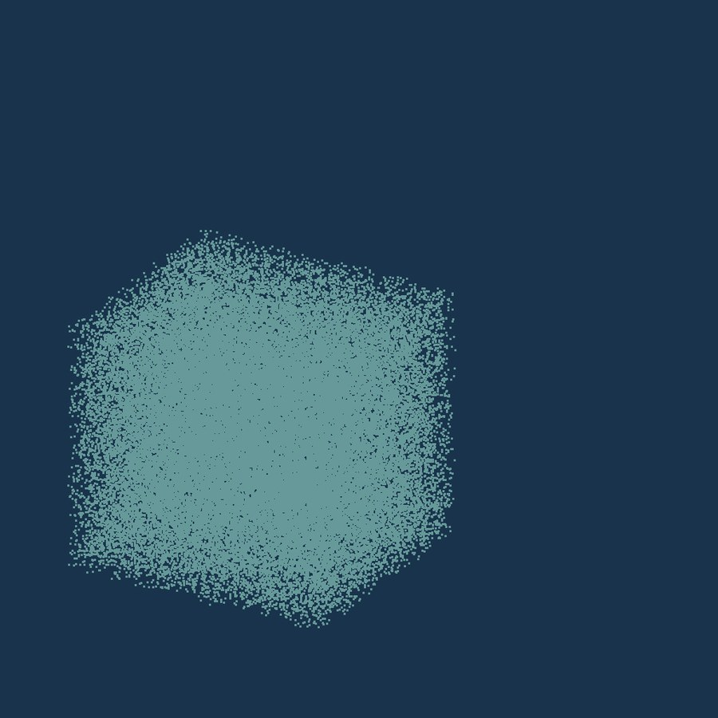

# example_mpm3d

A 3D Material Point Method solver: 65 536 particles scatter to a 64^3 grid and gather back every substep, then get drawn with an isometric projection.

| | |
|---|---|
| Group | `simulation` |
| Sources | `src/simulation/mpm3d.cpp` |
| Backends | dx, vk, cuda |
| Build | `xmake build example_mpm3d` |
| Run | `example_mpm3d dx --headless --frames 8 --capture mpm3d.jpg` |



## Purpose

MPM is a hybrid Lagrangian/Eulerian method: particles carry the material state, a
background grid carries momentum, and every substep moves data both ways. The example
is the 3D counterpart of `example_mpm88` and is worth reading for two reasons: it
shows a full practical pipeline of four kernels per substep, and it shows what a
particle-to-grid scatter costs in atomics. The material is Neo-Hookean elastic
(`E = 400`) with sticky walls on all six faces of the domain.

## Architecture

- **Host side.** Four particle buffers of 65 536 elements (`n_grid^3 / 4`):
  `Buffer<float3> x` positions, `Buffer<float3> v` velocities, `Buffer<float3x3> C`
  affine momentum, `Buffer<float> J` volume. The grid is one flat `Buffer<float>` of
  `64^3 * 4` entries holding `(vx, vy, vz, mass)` per cell, indexed by the `index()`
  helper that clamps to `n_grid - 1`. Particles start in a random cube of side 0.4
  (`seed 42` offline). `display` is a 1024x1024 `PixelStorage::BYTE4` image.
- **`clear_grid`** (3D, 8x8 block over 64x64x64) zeroes the four channels of a cell.
- **`point_to_grid`** (1D, 64-thread block over 65 536 particles) is the P2G scatter.
  It converts the particle position to grid coordinates, computes the three quadratic
  B-spline weights, the Neo-Hookean stress from `J`, and scatters momentum and mass to
  the 27 cells of its 3x3x3 stencil with `atomic(...).fetch_add` -- the only contended
  operation in the example.
- **`simulate_grid`** (3D, 8x8 block) normalises each cell by its mass, applies
  gravity (`9.8`), zeroes velocities that push into the `bound = 3` cell border and
  writes the cell back.
- **`grid_to_point`** (1D) is the G2P gather: it re-evaluates the same 27 weights,
  accumulates the new velocity, updates the APIC affine matrix with
  `4 * w * outer(v, dpos) / dx^2` and advances the volume with `J *= 1 + dt * tr(C)`.
- **`substep`** packs the four dispatches into one `CommandList`; a frame is 25
  substeps of `dt = 8e-5`, which is smaller than the 2D example needs.
- **Rendering** uses `T()`, a fixed isometric transform (28 degrees around one axis,
  32 around the other), `clear_display` and `draw_particles`, which stamps a 3x3 block
  per particle. `save_display_kernel` flattens the image into a `Buffer<float4>` on
  the device, because the host then clamps and rejects non-finite pixels before
  writing.
- **Offline path.** `--frames N` frames (default 200 in offline mode), one readback,
  a finiteness gate, then the image is written. With `-c` the comparison is made on
  foreground moments and a 16x16 density grid instead of pixels, because ordered
  floating-point atomics in the P2G scatter are not reproducible across schedulers.

## Usage

```bash
# interactive (needs a window and the gui module)
example_mpm3d dx

# offline, bounded by --frames
example_mpm3d dx --headless --frames 8 --capture mpm3d.jpg
example_mpm3d dx --offline --frames 200 --output-dir out
```

| Option | Meaning |
|---|---|
| `--headless`, `--offline` | no window, no swapchain; run the bounded loop and write the image |
| `--frames N` | number of simulated frames; defaults to 200 when offline |
| `--capture <file>` | write the result to exactly this file (`.png`, `.jpg`/`.jpeg`, `.bmp`, `.tga` select the container, anything else falls back to PNG); implies the offline path |
| `--output-dir <dir>` | where the default `test_mpm3d.png` is written (default: the working directory) |
| `-c`, `--compare <ref.png>` | compare foreground occupancy and moments against a reference image |

`--frames 1` gives a still of the initial block; a few dozen frames are enough to see
the cube collapse and spread.

## Result

A cyan blob on a dark blue background, viewed from above at a fixed isometric angle.
The offline run reports the frame count and the file:

```text
Headless MPM3D finished: 8 frame(s), wrote 'mpm3d.jpg'.
```

## See also

`example_mpm88` (the 2D version, much cheaper to run), `example_nbody_simulation`
(particles without a grid).
