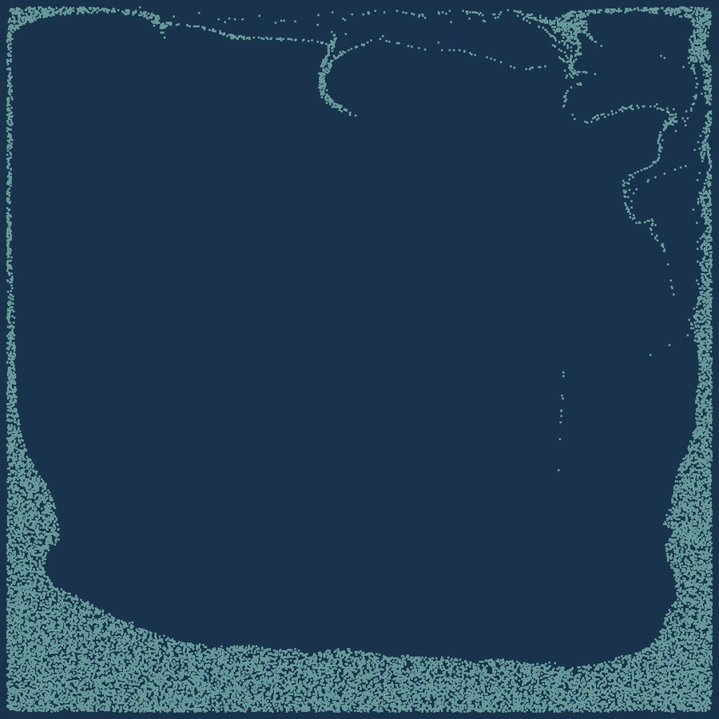

# example_mpm88

The 2D Material Point Method: 20 000 particles transfer momentum to a 200x200 grid and back, 24 substeps per frame.

| | |
|---|---|
| Group | `simulation` |
| Sources | `src/simulation/mpm88.cpp` |
| Backends | dx, vk, cuda |
| Build | `xmake build example_mpm88` |
| Run | `example_mpm88 dx --headless --capture mpm88.jpg` |



## Purpose

A compact, readable MPM solver: quadratic B-spline transfer, APIC affine momentum, a
Neo-Hookean elastic material and sticky walls, all in four small kernels. It follows
the formulation popularised by the "MPM88" sample and is the right starting point
before the larger 3D version. The grid is only 200x200 and the display is a debug
view, so the whole example stays cheap enough to iterate on.

## Architecture

- **Host side.** Particle state lives in four buffers of 20 000 elements
  (`n_grid^2 / 2`): `Buffer<float2> x`, `Buffer<float2> v`, `Buffer<float2x2> C` and
    `Buffer<float> J`. The Eulerian side uses two buffers: `grid_v` (`n_grid^2 * 2`
    floats, `vx` and `vy` interleaved) and `grid_m` (`n_grid^2` floats). Particles start
    in a square block with a downward initial velocity of `(0, -1)` so the material
    visibly falls into the walls.
- **`clear_grid`** (2D, dispatched over 200x200) zeroes both grid buffers through the
  `index()` helper, which clamps coordinates to the grid.
- **`point_to_grid`** (1D, one thread per particle) converts the position to grid
  coordinates, evaluates the three quadratic weights
  `0.5 (1.5 - fx)^2`, `0.75 - (fx - 1)^2`, `0.5 (fx - 0.5)^2`, adds the Neo-Hookean
  stress `-4 dt E vol (J - 1) / dx^2` to the APIC affine term, and scatters momentum
  and mass into the 3x3 stencil with `fetch_add` atomics.
- **`simulate_grid`** (2D) divides by mass where mass is non-zero, applies gravity,
  and zeroes a velocity component that pushes into the `bound = 3` cell border.
- **`grid_to_point`** (1D) gathers the 3x3 neighbourhood again, updates velocity and
  position with `dt = 1e-4`, and advances the deformation state with
  `J *= 1 + dt * tr(C)` and `C = 4 w outer(v, dpos) / dx^2`.
- **`substep`** records all four dispatches in one `CommandList`; a frame runs 24 of
  them, on the same stream.
- **Rendering** is `clear_display` (dark blue background) and `draw_particles`, which
  writes a 3x3 block per particle at 1024x1024.
- **Offline path.** 200 frames of 24 substeps, then `save_display_kernel` flattens the
  image into a `Buffer<float4>`, the host rejects non-finite pixels and the result is
  written. `-c` compares foreground moments and a 16x16 density grid rather than
  pixels, since the P2G atomics are not order-deterministic.

## Usage

```bash
# interactive (needs a window and the gui module)
example_mpm88 dx

# offline: 200 frames, one image out
example_mpm88 dx --headless --capture mpm88.jpg
example_mpm88 dx --offline --output-dir out
```

| Option | Meaning |
|---|---|
| `--headless`, `--offline` | no window, no swapchain; run the bounded loop and write the image |
| `--capture <file>` | write the result to exactly this file (`.png`, `.jpg`/`.jpeg`, `.bmp`, `.tga` select the container, anything else falls back to PNG); implies the offline path |
| `--output-dir <dir>` | where the default `test_mpm88.png` is written (default: the working directory) |
| `--frames N` | parsed by the shared option parser; this example's offline loop is fixed at 200 frames |
| `-c`, `--compare <ref.png>` | compare foreground occupancy and moments against a reference image |

## Result

A pale cyan elastic body that has already collapsed and spread over the floor of the
domain:

```text
Headless MPM88 finished: 200 frame(s) (24 substeps each), wrote 'mpm88.jpg'.
```

## See also

`example_mpm3d` (the same method with a 64^3 grid and a 27-point stencil),
`example_wave_equation` for a much simpler grid solver.
