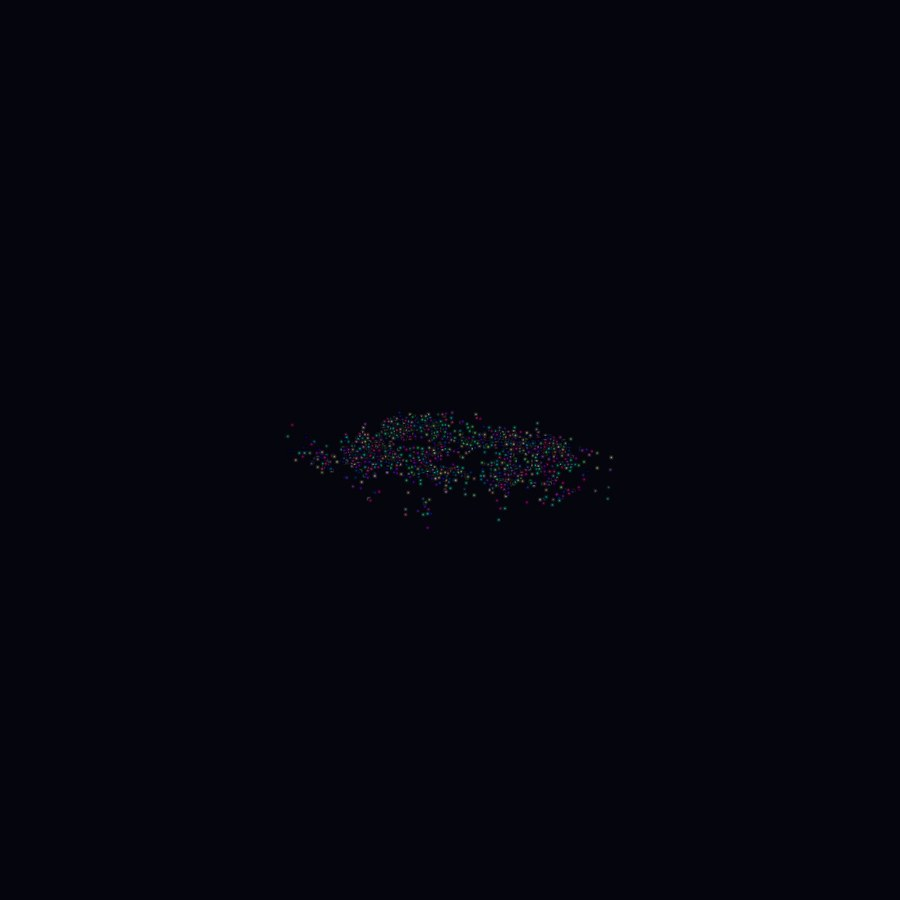

# example_nbody_simulation

A 2048-body gravitational simulation with an all-pairs force kernel and a depth-resolved, deterministic particle rasteriser.

| | |
|---|---|
| Group | `simulation` |
| Sources | `src/simulation/nbody_simulation.cpp`, `src/common/nbody_render_plan.h` |
| Backends | dx, vk, cuda |
| Build | `xmake build example_nbody_simulation` |
| Run | `example_nbody_simulation dx --headless --capture nbody.jpg` |



## Purpose

Two ideas in one page. The physics side is the simplest possible N-body solver: every
particle sums the softened gravitational force from every other particle, which is
`O(N^2)` and honest about it. The rendering side solves a subtler problem -- many
particles land on the same pixel, and atomic accumulation would make the picture depend
on thread scheduling. Here each pixel keeps a single winner chosen by an atomic minimum
on a packed key, so the same input always produces the same image.

## Architecture

- **Host side.** `Particle` holds `position`, `velocity`, `mass` and explicit padding,
  registered with `LUISA_STRUCT`; two buffers of 2048 particles (`particles_read`,
  `particles_write`) implement double buffering. Bodies start on a galaxy-like disk
  with radius 0.2 to 1.5, small vertical jitter, mass 0.5 to 2.0 and a tangential speed
  of `sqrt(G * M / r)` for an effective central mass of 500. Offline runs seed
  `std::mt19937` with 42.
- **`nbody_kernel`** (1D, `set_block_size(256)`, over 2048 bodies) loops over all
  particles, skips self-interaction, evaluates `f = G m1 m2 / (|r|^2 + eps^2)` and
  accumulates the vector force. Velocity and position advance with explicit Euler
  (`dt = 0.0005`, `G = 0.5`, `eps = 0.05`), velocity is damped by 0.999, and the result
  goes to the write buffer, which is swapped with the read buffer afterwards.
- **`nbody_render_plan.h`** holds what the host needs to reason about: `NBodyWinnerEncoding`
  packs a distance and a particle index into one `uint` (the low 11 mantissa bits are
  replaced by the index, which works because positive IEEE-754 floats compare like
  their bit patterns), `kNBodyGlowRadius = 2` fixes the 5x5 footprint, and
  `plan_nbody_footprint` mirrors the visibility rule.
- **`clear_particle_winners`** (1D, 256-thread block, over all 1024x1024 pixels) resets
  every winner slot to `kInvalid`.
- **`rasterize_particles`** (1D, 256-thread block, over 2048 particles) projects each
  body with the `camera_space` callable (Y then X rotation, perspective at a view
  distance of 4), drops bodies behind the camera or with non-finite coordinates, writes
  a `ParticleProjection` record and stamps its 5x5 footprint with `atomic(...).fetch_min`.
- **`resolve_particles`** (2D, 16x16 block, over 1024x1024) runs once all winners are
  final: it decodes the index, derives a per-body colour and a depth-dependent
  brightness, and applies an exponential falloff. Splitting arbitration from shading is
  what keeps the only contended operation an integer atomic minimum.
- **Offline path.** 100 frames with a fixed camera, then feature checks on the host
  (active and bright pixel counts, occupied 32x32 tiles) before the image is written, so
  an empty or overflowing frame fails instead of producing a plausible-looking file.

## Usage

```bash
# interactive (needs a window and the gui module)
example_nbody_simulation dx
# offline: 100 frames, one image out
example_nbody_simulation dx --headless --capture nbody.jpg
example_nbody_simulation dx --offline --output-dir out
```

| Option | Meaning |
|---|---|
| `--headless`, `--offline` | no window, no swapchain; run the bounded loop and write the image |
| `--capture <file>` | write the result to exactly this file (`.png`, `.jpg`/`.jpeg`, `.bmp`, `.tga` select the container, anything else falls back to PNG); implies the offline path |
| `--output-dir <dir>` | where the default `test_nbody_simulation.png` is written (default: the working directory) |
| `--frames N` | parsed by the shared option parser; this example's offline loop is fixed at 100 frames |
| `-c`, `--compare <ref.png>` | compare the result against a reference image and exit non-zero when it does not match |

In the window, dragging rotates the camera, the scroll wheel or `+`/`-` zooms, `R`
resets the view and `ESC` quits.

## Result

Coloured points with a soft glow over a dark blue background, the disk having sheared
into filaments after 100 frames:

```text
Headless N-body simulation finished: 100 frame(s), wrote 'nbody.jpg'.
```

## See also

`example_fire_simulation` (particles without mutual forces),
`example_mpm88` and `example_mpm3d` (particles that exchange momentum with a grid).
