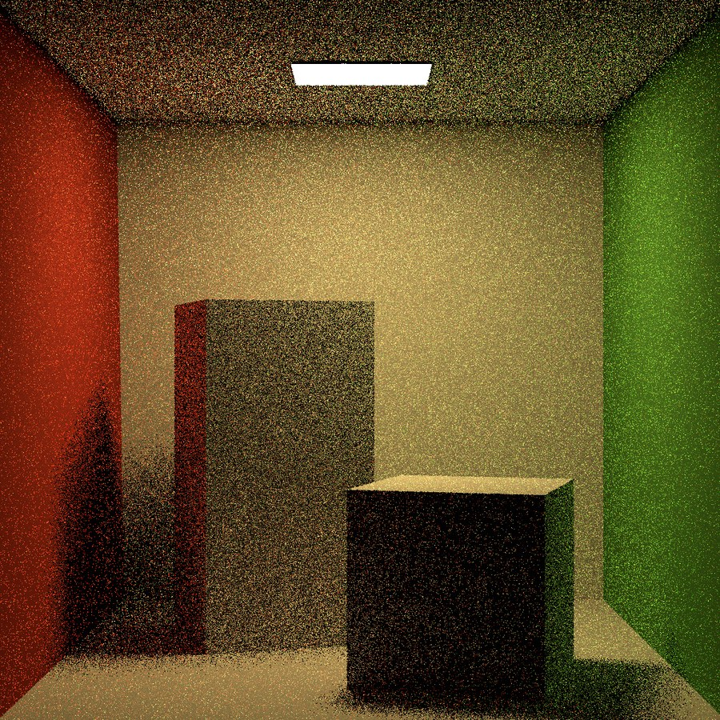

# example_path_tracing

Unidirectional path tracer for the Cornell Box, with next event estimation, MIS and Russian roulette.

| | |
|---|---|
| Group | `rendering` |
| Sources | `src/rendering/path_tracing.cpp`, `src/rendering/path_tracing_test.h`, `src/common/path_tracing_sample_plan.h` |
| Backends | dx, vk, cuda |
| Build | `xmake build example_path_tracing` |
| Run | `example_path_tracing dx --headless --spp 64 --capture cornell.jpg` |



## Purpose

The reference path tracer of the gallery: every other example in the family is a
variation of it. It shows how geometry becomes an acceleration structure, how a
shader traces a path, and how accumulation and tone mapping make a picture.

## Architecture

- **Scene.** The Cornell Box is an OBJ file embedded as a string in
  `cornell_box.h` (`obj_string`) and parsed with tinyobjloader. Each of the eight
  shapes becomes a `Buffer<Triangle>` plus a `Mesh`
  (`device.create_mesh(vertex_buffer, triangle_buffer)`); the triangle buffer is
  published into a `BindlessArray heap` so a shader can fetch the triangle a hit
  refers to by `hit.inst` / `hit.prim`.
- **Acceleration structure.** All meshes go into one `Accel` with an identity
  transform, built together with `heap.update()` on the same stream. Diffuse
  albedos live in a small `Buffer<float3> materials` indexed by instance; the
  emissive light is the last mesh and is recognised by instance index.
- **Kernels.** All are `Kernel2D` over a 1024×1024 grid. `make_sampler_kernel`
  hashes the pixel coordinate with TEA into an `INT1` `seed_image`;
  `raytracing_kernel` (16×16 block) loops `dispatch_spp` samples per pixel and up
  to 10 bounces each — `accel.intersect` for the surface, `accel.intersect_any`
  for the next-event shadow ray, `cosine_sample_hemisphere` with `Onb::to_world`
  for the BSDF, `balanced_heuristic` to weight light and BSDF pdfs, and Russian
  roulette to kill dim paths.
- **Accumulation.** `accumulate_kernel` adds `curr_image * curr.w` into the
  `FLOAT4` accumulation buffer, so one dispatch may carry several samples;
  `clear_kernel` resets it, `hdr2ldr_kernel` divides by the accumulated weight,
  applies `linear_to_srgb` and a fixed 2× scale into the `BYTE4` display image.
- **Loop and readback.** `luisa::ref::PathTracingSamplePassPlan`
  (`src/common/path_tracing_sample_plan.h`) owns the bound: `has_next()` and
  `next_dispatch_spp()` hand out the samples of each dispatch. Interactive runs
  present through a swapchain and never stop by themselves; offline runs stop at
  `total_spp`. One final `hdr2ldr_kernel`, then `ldr_image.copy_to(host_image)`
  and `luisa::gallery::image_io::write_image`.
- **Files.** `path_tracing.cpp` holds both `main()` (options, image output,
  `--compare`) and `run_path_tracing_test()`, which returns a
  `PathTracingTestResult` with the pixels and per-stage timings
  (`scene_setup_cpu_ms`, `acceleration_build_ms`, `render_ms`, `readback_ms`).
  `path_tracing_test.h` declares those structs so the same translation unit can be
  linked as a library (define `LUISA_PATH_TRACING_LIBRARY_ONLY` to strip `main()`),
  which is how the test mirrors reuse it.

## Usage

```bash
example_path_tracing dx                                # window, accumulates until closed
example_path_tracing dx --headless --spp 64 --capture cornell.jpg
```

| Option | Meaning |
|---|---|
| `--headless`, `--offline` | no window, no swapchain: render, write the image, exit |
| `--spp N` | samples per pixel; `0` means 1024 offline, unlimited in the window |
| `--max-spp-per-dispatch N` | samples batched into one dispatch (default 64, 1 on metal/fallback) |
| `--capture <file>` | write the picture to exactly this file; `.png`, `.jpg`, `.bmp` and `.tga` follow the extension; implies the headless path |
| `--output-dir DIR` | directory for the default output `test_path_tracing.png` |
| `--compare <file>`, `-c` | compare the result with a reference image, exit non-zero if it differs |
| `--frames N`, `--iterations N` | accepted by the shared parser; this example's loop is driven by `--spp` |

## Result

A 1024×1024 Cornell Box: red and green side walls, two grey boxes, the ceiling
light and the soft shadow it casts. Without `--capture` the picture goes to
`test_path_tracing.png` in the current directory (or `--output-dir`).

```
dt = 12.34ms (5184.00 spp/s)
Headless path tracing finished: 64 spp, wrote 'cornell.jpg'.
```

## See also

`example_path_tracing_camera` (first-person camera), `example_path_tracing_nested_callable`
(the same algorithm with nested DSL lambdas), `example_path_tracing_cutout` (alpha cut-outs
and ray queries).
