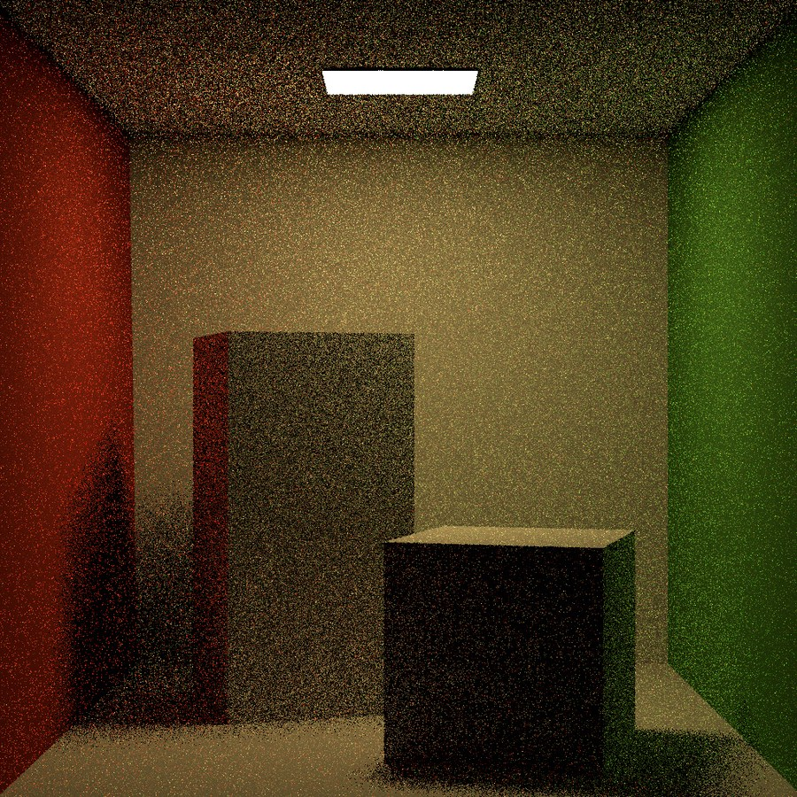

# example_path_tracing_camera

The Cornell Box path tracer driven by an interactive first-person camera you fly through the scene.

| | |
|---|---|
| Group | `rendering` |
| Sources | `src/rendering/path_tracing_camera.cpp`, `src/common/reference_compare.h` |
| Backends | dx, vk, cuda |
| Build | `xmake build example_path_tracing_camera` |
| Run | `example_path_tracing_camera dx --headless --spp 64 --capture camera.jpg` |



## Purpose

Same integrator as `example_path_tracing` — NEE, MIS with the balanced
heuristic, cosine-weighted diffuse bounces, Russian roulette, 10 bounces deep —
but the camera is an argument instead of a constant. The example is about the
loop around the renderer: how a moving viewpoint invalidates the accumulated
image, and how the CPU side feeds camera state to the GPU every frame.

## Architecture

- **Camera as a shader struct.** `Camera` holds `position`, `front`, `up`,
  `right` and `fov` and is declared with `LUISA_STRUCT`, so its
  `generate_ray(Float2 p)` member runs on the device: it builds a direction in the
  local frame from `tan(0.5 * fov)` and transforms it with the basis vectors.
  The camera is passed to `raytracing_kernel` as an ordinary kernel argument
  (`Var<Camera>`), not through a buffer.
- **Host controller.** `FPVCameraController` owns move/rotate/zoom speeds and
  re-orthonormalises the basis in its constructor. It applies `move_right`,
  `move_up`, `move_forward`, `rotate_pitch`, `rotate_yaw`, `rotate_roll` and
  `zoom`, each of which updates the `Camera` in place.
- **Input.** Mouse callbacks (`set_mouse_callback`,
  `set_cursor_position_callback`, `set_scroll_callback`) drive look-around and
  zoom; the frame loop reads `window->is_key_down` for `W/A/S/D` (pitch and yaw),
  `Q/E` (roll), `-`/`=` (zoom) and the arrow keys (strafe, or forward/back with
  `Shift`). Every handler sets `is_dirty`.
- **Kernels.** `make_sampler_kernel` seeds each pixel once; `raytracing_kernel`
  (16×16 block) traces exactly one sample per pixel per dispatch;
  `accumulate_kernel` folds the sample into the `FLOAT4` accumulation buffer;
  `clear_kernel` wipes it, which is what `is_dirty` triggers so the image starts
  converging again after a camera move; `hdr2ldr_kernel` divides by the sample
  count and applies `linear_to_srgb` only when the target is an 8-bit image, so a
  wider swapchain format keeps linear values.
- **Per-frame command list.** The seed, clear, trace, accumulate and present
  dispatches are queued into one `CommandList cmd_list`; interactive frames submit
  it with the swapchain present, offline frames just `commit()` and synchronize.
- **Offline bound.** `offline_total_spp = opts.spp == 0 ? 1024 : opts.spp` frames
  are accumulated, one sample each, then `ldr_image.copy_to(host_image)` and
  `luisa::gallery::image_io::write_image` write the result. `--compare` runs
  `compare_with_reference_file` on those pixels.
- **Files.** A single `src/rendering/path_tracing_camera.cpp` owns the whole
  program: option parsing, OBJ loading, the kernels, the input loop and the
  readback. It shares `cornell_box.h` with the rest of the family and takes the
  shared options from `luisa::ref::ExampleOptions` in
  `src/common/reference_compare.h`.

## Usage

```bash
example_path_tracing_camera dx                            # fly around with the mouse and WASD
example_path_tracing_camera dx --headless --spp 64 --capture camera.jpg
```

| Option | Meaning |
|---|---|
| `--headless`, `--offline` | no window: accumulate `--spp` frames, write the image, exit |
| `--spp N` | number of accumulated frames in offline mode (one sample per frame); `0` means 1024 |
| `--capture <file>` | write the picture to exactly this file; the container follows the extension; implies the headless path |
| `--output-dir DIR` | directory for the default output `test_path_tracing_camera.png` |
| `--compare <file>`, `-c` | compare the result with a reference image, non-zero exit on mismatch |

## Result

At the default viewpoint the picture is the Cornell Box seen from just inside the
open wall; as you move, it re-converges from a single noisy sample. `--spp 1` is
the noise floor, `--spp 64` a fair preview.

```
FPS: 1523
Headless path tracing (camera) finished: 64 frame(s) accumulated, wrote 'camera.jpg'.
```

## See also

`example_path_tracing` for the fixed camera, `example_path_tracing_nested_callable`
for the same scene with a different shader style, `example_blackhole` for another
free-flying camera.
