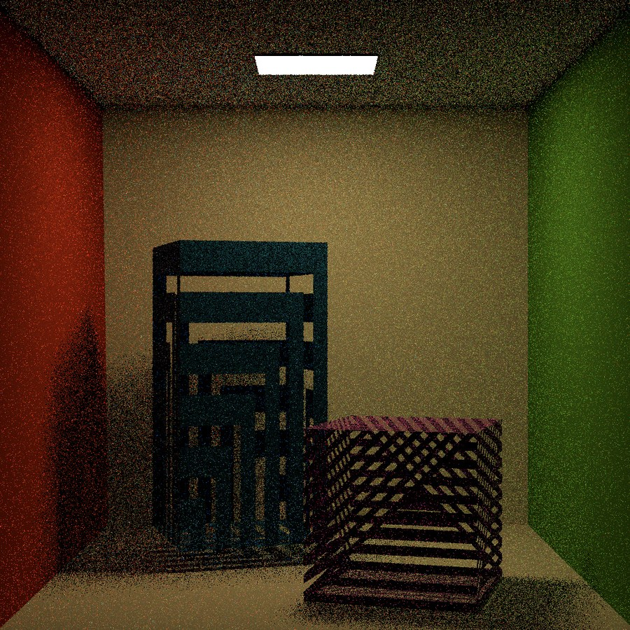

# example_path_tracing_cutout

The Cornell Box with striped alpha cut-outs in both boxes, traced through five ray-query strategies.

| | |
|---|---|
| Group | `rendering` |
| Sources | `src/rendering/path_tracing_cutout.cpp`, `src/common/path_tracing_sample_plan.h` |
| Backends | dx, vk, cuda |
| Build | `xmake build example_path_tracing_cutout` |
| Run | `example_path_tracing_cutout dx --headless --spp 16 --capture cutout.jpg` |



## Purpose

The two boxes carry a procedural, barycentric stripe mask instead of a texture, so
the hole pattern needs no UV map: `filter_triangle_hit` keeps a surface candidate
only where `fract(10 * bary.x) < 0.5` (short box) or `fract(6 * bary.y) < 0.6` (tall
box). The example expresses it five ways — commit filter inside a ray query,
unconditional commit, forced-opaque instances, plain closest-hit, hardware micromaps.

## Architecture

- **Scene.** The embedded Cornell Box OBJ. All shapes go into one `Accel` with
  `FAST_TRACE`, `allow_compaction` and `allow_update`;
  `accel.emplace_back(mesh, transform, 0xffu, opaque)` marks the room and the light
  opaque so traversal can auto-commit them. In `omm` mode the boxes must stay
  non-opaque, or `FORCE_OPAQUE` would make traversal ignore their micromap.
- **Trace strategies.** The kernel wraps traversal in two local callables,
  `trace_closest` and `trace_any`, switching on `TraceMode`: `accel.intersect` in
  `direct` mode, `accel.traverse(...).trace()` returning a `CommittedHit` in
  `opaque_query`, and `accel.traverse(...).on_surface_candidate(cb).trace()`
  elsewhere, where the callback calls `candidate.commit()` — unconditionally in
  `accept_query` and `omm`, and only where `filter_triangle_hit(candidate.hit())`
  passes in `cutout_query`.
- **Ray-query lowering.** `device.compile(raytracing_kernel, raytracing_option)`
  takes a `ShaderOption` with `enable_ray_query_pipeline`,
  `force_ray_query_pipeline` and `max_registers`, so the same callback compiles to
  the pipeline/IFT form or to the stateful loop.
- **Opacity micromaps.** `--trace-mode omm` bakes the stripe rule into an
  `OpacityMicromap`: a 256×256 `FLOAT4` mask, a `TwoState` micromap at
  `--omm-level` subdivisions, then
  `micromap.bake(mask.view(0u), uv_buffer.view(), triangle_buffer.view()).commit()`.
  The boxes are re-emitted de-indexed with `uv = {(0,0), (1,0), (0,1)}`, which makes
  `uv == bary`, and their meshes are built with `MeshCutoutMask{micromap}` so
  traversal, not the shader, discards the holes. Without device support
  (`OpacityMicromap::is_supported`) the mode falls back to `cutout-query`.
  `--omm-debug-view` dispatches `omm_debug_kernel`, which reads the packed bits back
  through `OpacityMicromap::data()` and writes them next to the render.
- **Loop.** `iteration_count = opts.iterations` outer iterations; each clears the
  accumulation image, reseeds, then runs the `PathTracingSamplePassPlan` loop. Every
  dispatch jitters the tall box (`accel.set_transform_on_update`) and rebuilds with
  `AccelBuildRequest::PREFER_UPDATE`, so the measured time includes the update; the
  median iteration time gives the throughput.

## Usage

```bash
example_path_tracing_cutout dx --headless --spp 16 --capture cutout.jpg
```

| Option | Meaning |
|---|---|
| `--headless`, `--offline` | no window: render, write the image, exit |
| `--spp N` | samples per pixel per iteration (`0` means 1024) |
| `--iterations N`, `--frames N` | how often the render repeats for the throughput median |
| `--max-spp-per-dispatch N` | samples batched into one dispatch (default 64, 1 on metal/fallback) |
| `--trace-mode M` | `cutout-query` (default), `accept-query`, `opaque-query`, `direct`, `omm` |
| `--omm-level N` | micromap subdivision level, clamped to the device maximum (default 5) |
| `--omm-conservative`, `--omm-debug-view` | conservative bake rule; also picture the unpacked micromap bits |
| `--ray-query-lowering L` | `pipeline` forces the pipeline/IFT form, `loop` the stateful loop |
| `--capture-float4s N`, `--max-registers N` | callback state size; register budget for the trace kernel |
| `--capture <file>`, `--output-dir DIR` | destination, or directory for `test_path_tracing_cutout.png` |
| `--compare <file>`, `-c` | compare with a reference image, non-zero exit on mismatch |

## Result

Both boxes look perforated by stripes, with the light falling through them onto the
floor. `cutout-query` and `omm` agree; the other modes show solid boxes.

```
Ray-query rendering median: 812.4 ms for 16 spp; throughput: 19.7 spp/s.
Headless path tracing (cutout) finished: 1 iteration(s), 16 spp, wrote 'cutout.jpg'.
```

## See also

`example_path_tracing` for the same integrator without cut-outs, `example_software_lbvh`
for a software traversal checked against the same hardware structures.
