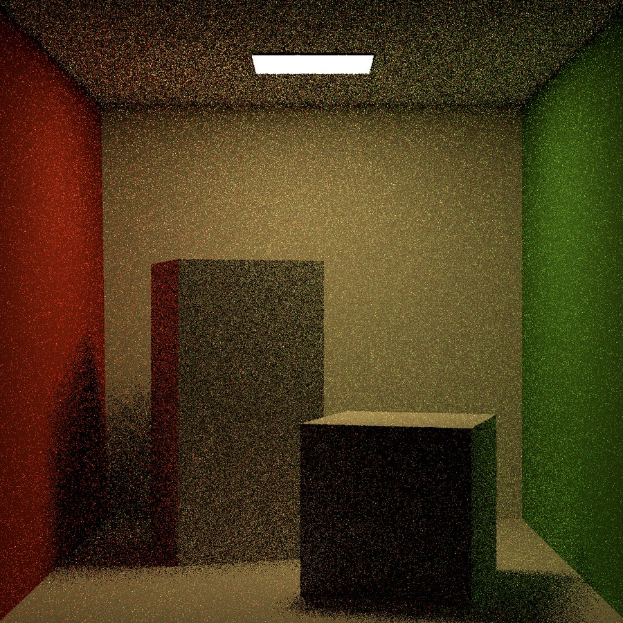

# example_path_tracing_hdr

The Cornell Box path tracer presenting into an HDR swapchain, with sRGB, PQ (ST.2084) and linear output paths.

| | |
|---|---|
| Group | `rendering` |
| Sources | `src/rendering/path_tracing_hdr.cpp`, `src/common/path_tracing_sample_plan.h` |
| Backends | dx, vk, cuda |
| Build | `xmake build example_path_tracing_hdr` |
| Run | `example_path_tracing_hdr dx --headless --spp 64 --capture hdr.jpg` |



## Purpose

A path tracer keeps radiance far above 1.0; this example is about what happens
between that accumulation buffer and a display. It shows how to ask a backend for a
wide-gamut HDR surface, how to read the display's luminance range, and how to
encode the same linear image three ways in one kernel.

## Architecture

- **Scene and kernels.** The embedded Cornell Box OBJ, one bindless array of
  triangle buffers, one `Accel`, a `Buffer<float3>` of albedos. `make_sampler_kernel`
  seeds the pixels, `raytracing_kernel` (16×16 block) traces `dispatch_spp`
  samples and writes radiance plus the sample weight, `accumulate_kernel` folds
  them into the `FLOAT4` accumulation buffer, `clear_kernel` resets it.
- **Display path.** On DirectX the example goes through `DXHDRExt`
  (`device.extension<DXHDRExt>()`): `create_swapchain` with a `DXSwapchainOption`
  whose storage is `R10G10B10A2` when `device_support_hdr()`, then
  `set_color_space(..., RGB_FULL_G2084_NONE_P2020)`. `get_display_data()` reports
  the panel's `max_full_frame_luminance`, which becomes the ACES `white_point`.
  Other backends use `device.create_swapchain` with `.wants_hdr = true`.
- **Encoding kernel.** `hdr2ldr_kernel(accum_image, ldr_image, scale, mode,
  white_point, aces)` divides by the accumulated weight, optionally applies
  `filmic_aces` (piecewise power curve, normalised by `filmic_aces(11.2 * white_point)`),
  and then picks an output encoding with `$switch (mode)`: `0` sRGB via
  `linear_to_srgb`, `1` 10-bit PQ via `rec709_to_rec2020` and `linear_to_st2084`
  (80 nits reference), `2` linear for a half-float back buffer.
- **Loop.** `PathTracingSamplePassPlan` bounds the run (`infinite` while a window
  is open). Each frame the kernel's `mode` is derived from the swapchain storage,
  the trace and accumulate dispatches are queued in a `CommandList` and, when a
  window exists, the encode plus `swap_chain->present(ldr_image)` are appended.
- **Offline.** No window, so the encode that produces the file always uses mode
  `0`: the picture on disk is ordinary sRGB, identical in structure to the
  interactive SDR fallback. One final encode, `ldr_image.copy_to(host_image)`,
  then `luisa::gallery::image_io::write_image` and, with `--compare`,
  `compare_with_reference_file`.
- **Files.** A single `src/rendering/path_tracing_hdr.cpp`; options come from
  `luisa::ref::ExampleOptions` and the sample plan from
  `src/common/path_tracing_sample_plan.h`.

## Usage

```bash
example_path_tracing_hdr dx                             # HDR window if the display supports it
example_path_tracing_hdr dx --headless --spp 64 --capture hdr.jpg
```

| Option | Meaning |
|---|---|
| `--headless`, `--offline` | no window: render, write an sRGB picture, exit |
| `--spp N` | samples per pixel offline (`0` means 1024); an open window keeps sampling |
| `--capture <file>` | write the picture to exactly this file; the container follows the extension; implies the headless path |
| `--output-dir DIR` | directory for the default output `test_path_tracing_hdr.png` |
| `--compare <file>`, `-c` | compare the result with a reference image, non-zero exit on mismatch |

HDR presentation is only entered without `--headless`; on a display that is not in
HDR mode the DirectX path falls back to an 8-bit surface and the sRGB encoding.

## Result

The file on disk is the Cornell Box encoded as sRGB; an HDR window goes through the
display's own tone mapping (ACES plus PQ) instead. The console reports the chosen
surface and, on HDR hardware, the panel data:

```
Display data:
bits_per_color: 10
max_luminance: 1000
dt = 9.87ms (6484.00 spp/s)
Headless HDR path tracing finished: 64 spp, wrote 'hdr.jpg'.
```

## See also

`example_path_tracing` for the plain swapchain version, `example_win_hdr` for a
window that only negotiates an HDR surface.
