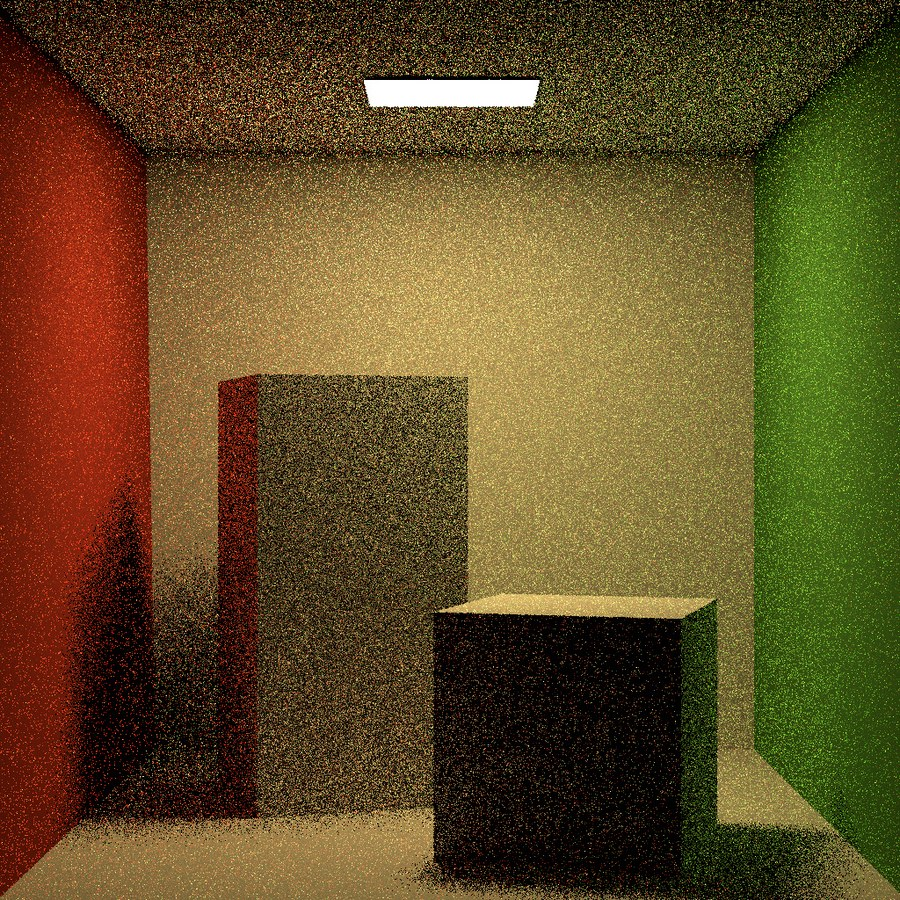

# example_path_tracing_nested_callable

The Cornell Box path tracer written with nested DSL lambdas, so NEE and BSDF sampling become reusable blocks.

| | |
|---|---|
| Group | `rendering` |
| Sources | `src/rendering/path_tracing_nested_callable.cpp` |
| Backends | dx, vk, cuda |
| Build | `xmake build example_path_tracing_nested_callable` |
| Run | `example_path_tracing_nested_callable dx --headless --spp 64 --capture nested.jpg` |



## Purpose

The rendered image is the Cornell Box again — same scene, same integrator — but
the shader is organised differently. Instead of separate `Callable`s and explicit
`UInt &state` parameters, the whole path tracer is one kernel whose sub-steps are
`$lambda` closures that capture the surrounding DSL variables. It is the page to
read if you want to factor a large kernel without passing a dozen expressions
through every helper.

## Architecture

- **Scene.** Identical to `example_path_tracing`: the embedded Cornell Box OBJ,
  one `Buffer<Triangle>` and one `Mesh` per shape, a `BindlessArray` for
  triangle lookup, a single `Accel` with identity transforms, and an eight-entry
  `Buffer<float3>` of albedos.
- **Closure-typed RNG.** `Lambda lcg = [&state] { ... }` is defined *inside*
  `raytracing_kernel`. It captures `state` — the per-pixel generator state read
  from `seed_image` — by reference, so every later closure that draws a random
  number uses the same generator and the state is written back once at the end.
- **Nested blocks.** The next-event-estimation step is a
  `$lambda({ ... })()` that samples the light, builds the shadow ray and
  `accel.intersect_any` it, with the occlusion test written as a second,
  nested `$lambda({ ... })()` — the shader reads as the nesting of the algorithm
  rather than as a flat list of instructions.
- **Result state in `luisa::optional`.** Values that two closures must share — the
  offset shading point `pp` and the albedo `albedo` — are declared as
  `luisa::optional<Float3>` before the blocks and filled with `emplace()`. The
  NEE block writes them, the BSDF block reads them, and the C++ scope decides
  their lifetime. `sample_f` is a `$lambda((Float2 u) { ... })` value, so the
  caller passes the two random numbers and gets the new direction, the new pdf and
  the throughput update in the captured variables.
- **Kernels.** `make_sampler_kernel` seeds via TEA, `raytracing_kernel` (16×16
  block) traces `dispatch_spp` samples per pixel and up to 10 bounces,
  `accumulate_kernel` folds the sample and its weight into the `FLOAT4`
  accumulation buffer, `clear_kernel` resets it, and `hdr2ldr_kernel` divides by
  the weight and applies `linear_to_srgb` with a 2× scale.
- **Compilation.** Each kernel is compiled with `ShaderOption` and a `name`
  (`"raytracing"`, `"clear"`, `"hdr2ldr"`, `"accumulate"`, `"make_sampler"`), which
  is what the backend logs and profiles show.
- **Loop and readback.** A `PathTracingSamplePassPlan` loop dispatches trace plus
  accumulate; interactive frames present through a swapchain, offline frames only
  commit and synchronize, then `ldr_image.copy_to(host_image)` and
  `luisa::gallery::image_io::write_image`. Everything lives in
  `src/rendering/path_tracing_nested_callable.cpp`.

## Usage

```bash
example_path_tracing_nested_callable dx                          # window, live accumulation
example_path_tracing_nested_callable dx --headless --spp 64 --capture nested.jpg
```

| Option | Meaning |
|---|---|
| `--headless`, `--offline` | no window: render, write the image, exit |
| `--spp N` | samples per pixel offline (`0` means 1024); an open window keeps sampling |
| `--capture <file>` | write the picture to exactly this file; the container follows the extension; implies the headless path |
| `--output-dir DIR` | directory for the default output `test_path_tracing_nested_callable.png` |
| `--compare <file>`, `-c` | compare the result with a reference image, non-zero exit on mismatch |

## Result

The same Cornell Box as `example_path_tracing`, pixel-comparable: the closures do
not change the mathematics, only how the shader is assembled. The console prints
the running sample count:

```
spp: 32, time: 210.53 ms, spp/s: 152.00
FPS: 148
Headless nested-callable path tracing finished: 64 spp, wrote 'nested.jpg'.
```

## See also

`example_path_tracing` for the flat version, `example_coro_path_tracing` for the
same integrator expressed as coroutines.
