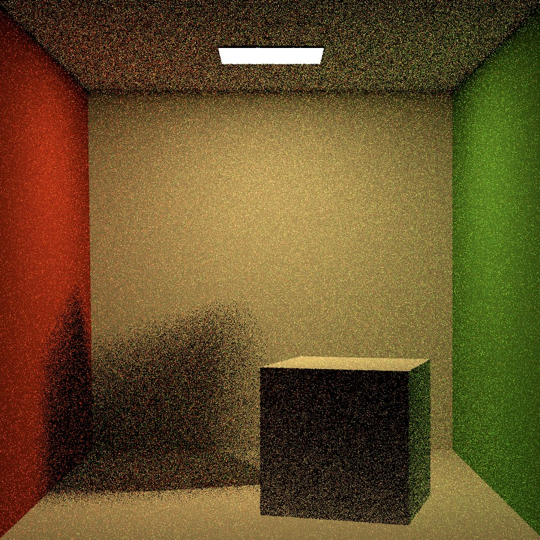

# example_path_tracing_ray_masks

The Cornell Box path tracer using instance visibility masks to hide one box from camera rays and the other from shadow rays.

| | |
|---|---|
| Group | `rendering` |
| Sources | `src/rendering/path_tracing_ray_masks.cpp`, `src/common/path_tracing_sample_plan.h` |
| Backends | dx, vk, cuda |
| Build | `xmake build example_path_tracing_ray_masks` |
| Run | `example_path_tracing_ray_masks dx --headless --spp 64 --capture masks.jpg` |



## Purpose

Every `Ray` carries a visibility mask, and every acceleration-structure instance
carries the mask it belongs to; a ray only sees an instance when the two masks
share a bit. This example uses that to make one box invisible to the eye but
present for shadows, and the other visible to the eye but absent from shadows —
two different pictures of the same geometry, with no shader-side filtering and no
extra traversal.

## Architecture

- **Scene.** The embedded Cornell Box OBJ, one `Buffer<Triangle>` and `Mesh` per
  shape, a `BindlessArray` for triangle lookup and one `Accel`, exactly as in
  `example_path_tracing`.
- **Masks on instances.** Two constants name the bits,
  `tall_box_ray_mask = 1u << 0u` and `short_box_ray_mask = 1u << 1u`, and the two
  boxes are appended with
  `accel.emplace_back(mesh, make_float4x4(1.0f), mask)`; the other six instances
  keep the default full mask.
- **Masks on rays.** The primary ray is traced with
  `accel.intersect(ray, {.visibility_mask = ~tall_box_ray_mask})`, so the tall box
  can never be hit by the eye ray and leaves a hole in the picture. The
  next-event shadow ray uses
  `accel.intersect_any(shadow_ray, {.visibility_mask = ~short_box_ray_mask})`, so
  the short box never blocks the light and casts no shadow. The result is a box
  floating without a shadow next to a shadow with no box.
- **Materials.** The eight albedos are a `Constant` array in the shader
  (`Constant materials{...}`) read with `materials.read(hit.inst)`, so no buffer
  and no bindless slot are involved.
- **Kernels.** `make_sampler_kernel` seeds pixels with TEA and `lcg`;
  `raytracing_kernel` (16×16 block) traces `dispatch_spp` samples per pixel, up to
  10 bounces, with `reorder_shader_execution()` after the `accel.intersect` to let
  the backend regroup the lanes that still have work; `accumulate_kernel`
  adds `curr * curr.w` into the `FLOAT4` accumulation image; `clear_kernel` resets
  it; `hdr2ldr_kernel` divides by the weight and applies `linear_to_srgb`.
- **Loop.** A `PathTracingSamplePassPlan` drives the dispatches. Interactive runs
  present through a swapchain (`back_buffer_count = 8`, so a slow frame does not
  stall the queue), offline runs only commit and synchronize.
- **Readback.** `ldr_image.copy_to(host_image)` then
  `luisa::gallery::image_io::write_image`, followed by the optional
  `compare_with_reference_file`. One file,
  `src/rendering/path_tracing_ray_masks.cpp`.

## Usage

```bash
example_path_tracing_ray_masks dx                          # window, live accumulation
example_path_tracing_ray_masks dx --headless --spp 64 --capture masks.jpg
```

| Option | Meaning |
|---|---|
| `--headless`, `--offline` | no window: render, write the image, exit |
| `--spp N` | samples per pixel offline (`0` means 1024); an open window keeps sampling |
| `--capture <file>` | write the picture to exactly this file; the container follows the extension; implies the headless path |
| `--output-dir DIR` | directory for the default output `test_path_tracing_ray_masks.png` |
| `--compare <file>`, `-c` | compare the result with a reference image, non-zero exit on mismatch |

## Result

A Cornell Box with a single visible box standing in the light, a dark shadow on
the floor that belongs to nothing, and colour bleeding from the walls that is
still physically consistent — the masks only hide geometry, they do not remove its
contribution.

```
dt = 11.02ms (5807.00 spp/s)
Headless path tracing (ray masks) finished: 64 spp, wrote 'masks.jpg'.
```

## See also

`example_path_tracing` for the unmasked scene,
`example_path_tracing_cutout` for the other way of making geometry disappear from
a traversal.
