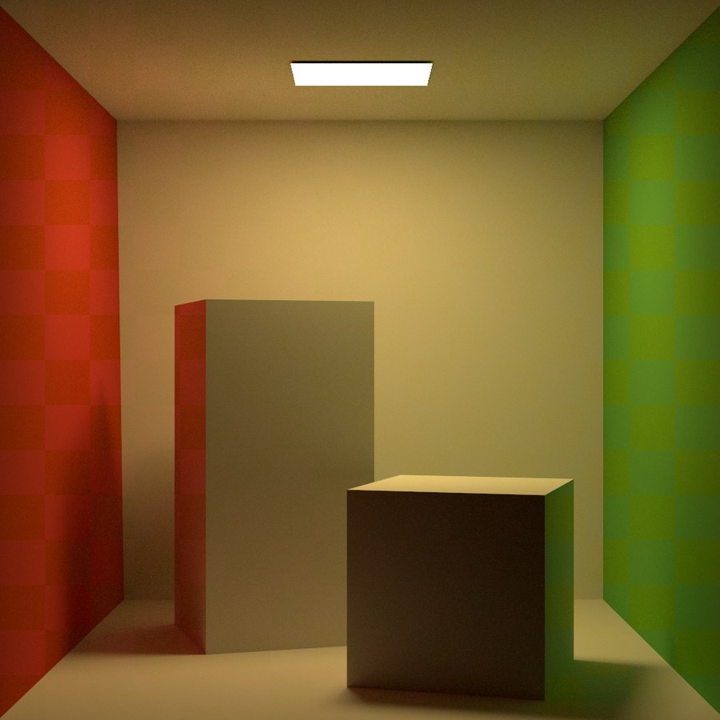

# example_path_tracing_spectrum

Spectral path tracing next to RGB path tracing in one image, with reflectances stored as Fourier moments.

| | |
|---|---|
| Group | `rendering` |
| Sources | `src/rendering/path_tracing_spectrum.cpp`, `src/rendering/srgb_to_fourier_embedded.hpp` |
| Backends | dx, vk |
| Build | `xmake build example_path_tracing_spectrum` |
| Run | `example_path_tracing_spectrum dx --headless --spp 64 --capture spectrum.jpg` |



## Purpose

Instead of carrying an RGB triple through the path, this renderer carries a
reflectance spectrum and shades at three sampled wavelengths. The picture is a
checkerboard of 64-pixel tiles alternating between the spectral and the ordinary
RGB renderer, so the difference — colour bleeding, the tint of the light — is
visible side by side. A spectrum fits in a shader value as three complex moments.

## Architecture

- **Complex moments.** `struct complex` plus `LUISA_STRUCT(complex, real, imag)`
  gives a device type with `conjugate()` and `abs_square()`, and free operators for
  `+`, `-`, `*`, `/` on `Var<complex>`.
  `trigonometricToExponentialMomentsReal3`, `levinsonsAlgorithm3` and
  `computeAutocorrelation3` convert to and from the Lagrange form, and the
  `prepareReflectanceSpectrumLagrangeReal3` /
  `evaluateReflectanceSpectrumLagrangeReal3` pair from `spectrum_data.h` is what
  the shader calls.
- **Lookup tables.** Four resources are bound into one `BindlessArray lut_heap`
  with `Sampler::linear_linear_mirror`: `srgb_to_fourier_even`, a
  `Volume<float>` in `PixelStorage::R10G10B10A2` loaded from the embedded
  `SRGBToFourierEvenPacked.dat` (exported as
  `luisa_compute_SRGBToFourierEvenPacked`, see `srgb_to_fourier_embedded.hpp`);
  `cie_xyz_cdfinv`, a 2048×1 `FLOAT4` inverse CDF built on the host with
  `generate_quantiles` over the CIE 1931 colour-matching functions; `illum_d65`,
  the D65 illuminant sampled every 10 nm; and `bmese_phase`, a phase table every
  5 nm. The wavelength domain is 360–830 nm.
- **Callables.** `lsrgb_to_lagrange` samples the 3D table and maps the packed
  value into trigonometric moments; `spectrum_reflectance(lambda, lagrange)`
  evaluates a reflectance at a wavelength; `d6_normalized(lambda)` does the same
  for the illuminant; `sample_xyz` turns two random numbers into the three
  wavelengths the path is shaded at.
- **One kernel, two renderers.** `raytracing_kernel` (16×16 block) computes
  `use_spectrum = (block_id().x / 4 + block_id().y / 4) % 2 == 1`, so the parity of
  the 64-pixel tile decides whether a path shades spectrally or in RGB. Both
  branches run the same integrator: `accel.intersect`, `accel.intersect_any` for
  NEE, cosine-weighted bounces, `balanced_heuristic` MIS, Russian roulette.
- **Rest of the pipeline.** `make_sampler_kernel` (TEA) seeds, `accumulate_kernel`
  folds sample times weight into the `FLOAT4` accumulation image,
  `hdr2ldr_kernel` divides by the weight and applies `linear_to_srgb`. The
  `PathTracingSamplePassPlan` loop dispatches them, then
  `ldr_image.copy_to(host_image)` and `luisa::gallery::image_io::write_image`
  produce the file. All of it is `src/rendering/path_tracing_spectrum.cpp`.

## Usage

```bash
example_path_tracing_spectrum dx                          # window, live accumulation
example_path_tracing_spectrum dx --headless --spp 64 --capture spectrum.jpg
```

| Option | Meaning |
|---|---|
| `--headless`, `--offline` | no window: render, write the image, exit |
| `--spp N` | samples per pixel offline (`0` means 1024); an open window keeps sampling |
| `--capture <file>` | write the picture to exactly this file; the container follows the extension; implies the headless path |
| `--output-dir DIR` | directory for the default output `test_path_tracing_spectrum.png` |
| `--compare <file>`, `-c` | compare the result with a reference image, non-zero exit on mismatch |

The sampled `R10G10B10A2` volume is not accepted by the CUDA backend, so dx and vk
are the supported targets.

## Result

A 1024×1024 Cornell Box covered in a checkerboard of 64-pixel squares: the two
halves agree in structure and differ in the tint of the indirect light.

```
dt = 46.71ms (1370.00 spp/s)
Headless spectral path tracing finished: 64 spp, wrote 'spectrum.jpg'.
```

## See also

`example_path_tracing` for the RGB reference renderer,
`example_path_tracing_nested_callable` for another restructuring of the same integrator.
