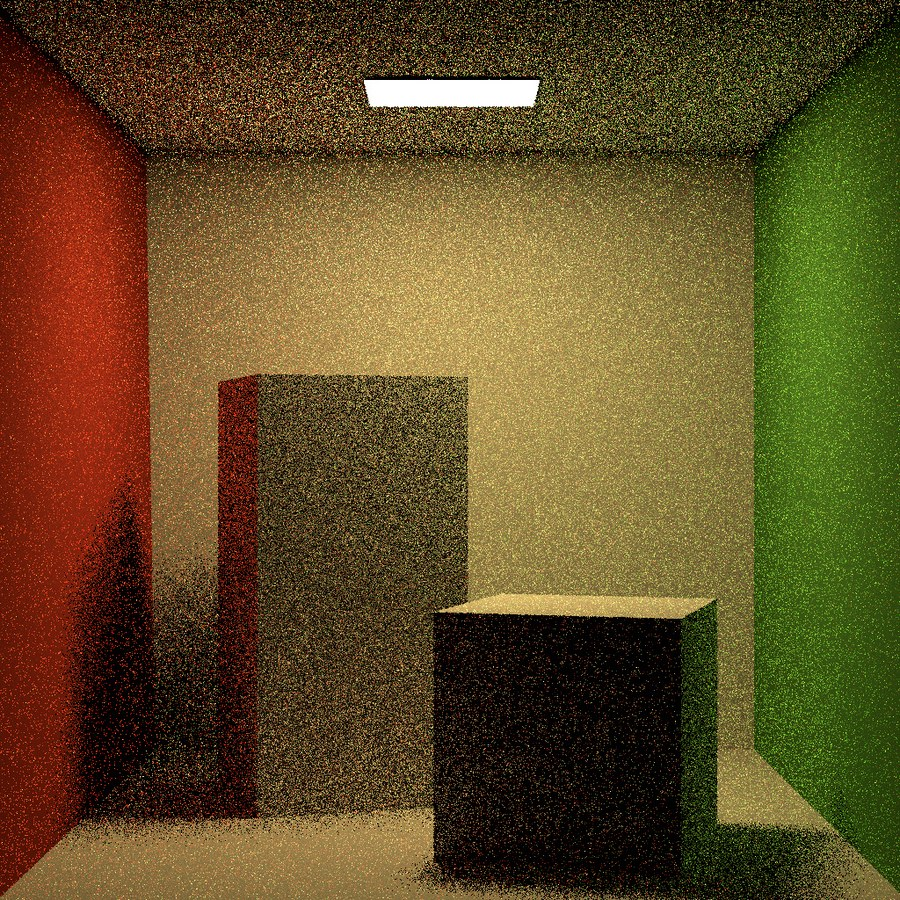

# example_path_tracing_xir2ast

The Cornell Box path tracer written in the LuisaCompute DSL, recorded to AST,
translated to XIR and lowered back to AST before it is compiled for the backend.

| | |
|---|---|
| Group | `rendering` |
| Sources | `src/rendering/path_tracing_xir2ast.cpp` |
| Backends | dx, vk, cuda |
| Build | `xmake build example_path_tracing_xir2ast` |
| Run | `example_path_tracing_xir2ast dx --headless --spp 64 --capture cornell.jpg` |



## Purpose

The scene, the estimator and the sampling are the ones from `example_path_tracing`:
unidirectional path tracing with next-event estimation, multiple importance
sampling, cosine-weighted hemisphere sampling and Russian roulette. The subject
here is the **route** the shader takes — the lambda is recorded as an AST, the AST
is translated into XIR (`xir::ast_to_xir_translate`), and the XIR kernel definition
is translated back into an AST (`xir::xir_to_ast_translate`), which is what
`device.compile` finally sees.

This shows that XIR is a semantics-preserving interchange point: a real renderer
round-trips through it with every feature intact (ray queries,
`reorder_shader_execution`, bindless buffers, nested loops with early exit) and
still produces exactly the same picture. Nothing about the command line changes,
and at the same `--spp` the captured image is byte-identical to
`example_path_tracing`'s, because the backend receives the same program.

## Architecture

**Host setup.** tinyobjloader parses the Cornell Box OBJ embedded as `obj_string`
in the shared `cornell_box.h`. Every shape becomes a `Mesh` over one shared
`Buffer<float3>` of vertices plus its own `Buffer<Triangle>`, bound into
`BindlessArray heap` at the shape index with
`heap.emplace_on_update(index, triangle_buffer)`. All meshes go into
`Accel accel` with identity transforms, and `materials` is a `Buffer<float3>` of
eight albedos in shape order (the last one is the light).

**The kernel.** `raytracing_kernel` is a `Kernel2D` with `set_block_size(16, 16, 1)`
and the signature
`(ImageFloat image, ImageUInt seed_image, AccelVar accel, UInt2 resolution, UInt dispatch_spp)`.
Per pixel it reads `seed_image.read(coord).x`, then `$for (i, dispatch_spp)`
accumulates samples: `lcg(state)` jitters the pixel, `generate_ray` builds a ray
through a 27.8° field of view, and `$for (depth, 10u)` walks the path with
`accel.intersect(ray, {})`, `reorder_shader_execution()`, the triangle fetched
through `heap_ref->buffer<Triangle>(hit.inst)` and `triangle_interpolate` for the
hit position. Light is handled twice with `balanced_heuristic` weighting: emitter
hits inside the loop, and an explicit sample guarded by
`accel.intersect_any(shadow_ray, {})`. The bounce uses `cosine_sample_hemisphere`
through `make_onb(n)` with `pdf_bsdf = cos_wi * inv_pi`, then Russian roulette on
the luminance of `beta`.

**The XIR round trip.** A file-local helper does the work:

```cpp
auto module = xir::ast_to_xir_translate(function, {});
auto config = xir::XIR2ASTConfig{.bound_arguments = function.bound_arguments()};
return xir::xir_to_ast_translate(*kernel_definition, config);
```

`bound_arguments` re-establishes the captured `heap`, `vertex_buffer` and
`materials` references, so the lowered AST binds the same resources.
`raytracing_kernel` and `make_sampler_kernel` are compiled from the translated
function, e.g.
`device.compile(Kernel<2, Image<float>, Image<uint>, Accel, uint2, uint>{raytracing_ast})`,
while `accumulate_kernel`, `clear_kernel` and `hdr2ldr_kernel` take the ordinary
route, so both compilation paths sit side by side in one file.

**Sampling and output.** `luisa::ref::PathTracingSamplePassPlan` decides how many
samples each dispatch carries: 1024 when `--spp` is absent, capped by
`--max-spp-per-dispatch` (64, or 1 on `metal`/`fallback`). `accumulate_kernel` sums
weighted radiance and `hdr2ldr_kernel` divides by the weight and applies
`linear_to_srgb` before the `BYTE4` image is copied back and written to
`test_path_tracing.png` or the `--capture` path.

## Usage

```bash
example_path_tracing_xir2ast dx # window
example_path_tracing_xir2ast dx --headless --spp 64 --capture cornell.jpg
example_path_tracing_xir2ast cuda --headless --spp 4 --max-spp-per-dispatch 1
```

| Option | Meaning |
|---|---|
| `--headless` / `--offline` | Render without a window and exit |
| `--spp N` | Total samples per pixel (default 1024) |
| `--max-spp-per-dispatch N` | Samples per dispatch, i.e. the size of one accumulation step |
| `--capture <file.png\|file.jpg>` | Destination file; the extension picks the container |
| `--output-dir DIR` | Directory for the default `test_path_tracing.png` |
| `--compare <ref.png>` / `-c <ref.png>` | PSNR/correlation check, non-zero exit on failure |

The target is only built when the LuisaCompute XIR module is enabled in the build
configuration.

## Result

The Cornell Box at 1024×1024: warm ceiling light, white floor and back wall, green
right wall, red left wall, and the two boxes casting soft shadows. One sample per
pixel already resolves the room; raise `--spp` to smooth the remaining grain.

## See also

`example_path_tracing` for the same renderer compiled straight from the AST,
`example_sdf_renderer_xir2ast` for the SDF counterpart of this round trip.
