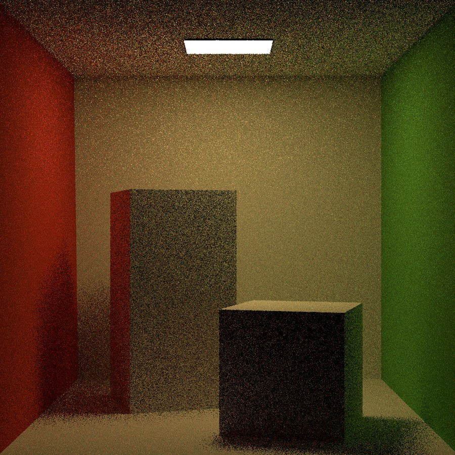

# example_photon_mapping

Two-pass photon mapping for the Cornell Box: photons are traced into a uniform grid, then gathered by eye rays.

| | |
|---|---|
| Group | `rendering` |
| Sources | `src/rendering/photon_mapping.cpp`, `src/common/photon_mapping_plan.h` |
| Backends | dx, vk, cuda |
| Build | `xmake build example_photon_mapping` |
| Run | `example_photon_mapping dx --headless --spp 64 --capture photons.jpg` |



## Purpose

A different global-illumination algorithm on the same scene. Light travels from the
emitter by photons instead of backward from the camera: one pass shoots a million
photons and files them into a grid, a second pass estimates density where a camera
ray hits. It shows a spatial structure built without sorting, and a sum of
thousands of contributions per pixel without float atomics.

## Architecture

- **Scene.** The embedded Cornell Box OBJ, a `BindlessArray` of triangle buffers
  and one `Accel`. `Material` (albedo plus emission) is a buffer element, and the
  light is the only instance with a non-zero emission.
- **Compile-time budget.** `photon_mapping::plan_photon_storage(photon_number,
  max_depth)` proves one million photons times eight bounces fit an `uint32` index
  space and yields `photon_capacity`;
  `plan_fixed_point_accumulator(photon_capacity, 70u, 24u)` proves the matching
  fixed-point accumulator cannot overflow. Both are `constexpr` with a
  `static_assert` on `valid`, so changing the scene bounds fails the build.
- **Grid.** The host scans the OBJ vertices for the scene AABB, picks
  `split_per_dim = 128`, and derives `grid_len` and `grid_size`.
  `grid_head_buffer` holds one `uint` per cell — a linked-list head, `~0u` when
  empty — cleared by `clear_grid_kernel`, a `Kernel1D` over the cells.
- **Photon pass.** `photon_tracing_kernel` is a `Kernel1D` over `photon_number`:
  each thread samples a position and direction on the area light, turns them into
  `power`, then for each of `max_depth` bounces intersects the scene, writes a
  `Photon{position, power, in_direction, nxt}` and links it into its cell with
  `grid_head_buffer->atomic(index).exchange(slot)`. The slot,
  `dispatch_x() * max_depth + depth`, means a path owns its addresses and no
  allocator is needed; only the list insertion is unordered.
- **Gathering pass.** `photon_gathering_kernel` (a `Kernel2D` over 1024×1024)
  traces one camera ray per pixel, adds direct lighting with next-event sampling
  and `balanced_heuristic` MIS, then takes one cosine-weighted bounce and calls
  `indirect_illumination`, which walks the 3×3×3 neighbourhood of cells through
  `density_estimation_radius(p, radius, material)` with `photon_radius = 0.007`,
  scaled by `inv_pi / (radius² · photon_count)`. Each contribution is quantised
  into a two-word fixed-point accumulator by `accumulate_photon_contribution` and
  read back by `decode_photon_contribution`, so traversal order cannot change the
  result and no floating-point atomic is needed.
- **Loop and readback.** `accumulate_kernel` adds one gathered frame per
  iteration, `hdr2ldr_kernel` tone maps; offline runs stop at `--spp` (default
  256), then `ldr_image.copy_to(host_image)` and
  `luisa::gallery::image_io::write_image` write `test_photon_mapping.png`.

## Usage

```bash
example_photon_mapping dx                          # window, live accumulation
example_photon_mapping dx --headless --spp 64 --capture photons.jpg
```

| Option | Meaning |
|---|---|
| `--headless`, `--offline` | no window: gather `--spp` frames, write the image, exit |
| `--spp N` | gathered samples per pixel offline (`0` means 256); an open window keeps gathering |
| `--capture <file>` | write the picture to exactly this file; implies the headless path |
| `--output-dir DIR` | directory for the default output `test_photon_mapping.png` |
| `--compare <file>`, `-c` | compare with a reference image, non-zero exit on mismatch |

The photon distribution is fixed-seeded offline, so `--compare` sees the same photons.

## Result

The Cornell Box with softer, blurrier indirect light than the path tracers, and a
faint graininess where the photon radius catches few neighbours at low sample counts.

```
grid_size 12 8 12
Photon tracing done
Headless photon mapping finished: 64 spp, wrote 'photons.jpg'.
```

## See also

`example_path_tracing` for backward path tracing of the same scene,
`example_path_tracing_spectrum` for another step away from plain RGB radiance.
