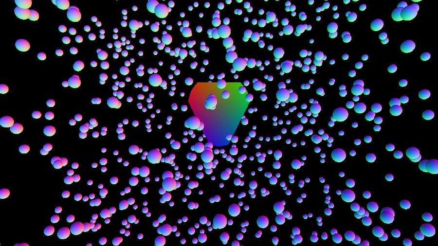

# example_procedural

Ray-query renderer for procedural primitives: 1024 spheres that exist only as
AABBs, plus a triangle mesh whose hits are filtered by a surface-candidate hook.

| | |
|---|---|
| Group | `rendering` |
| Sources | `src/rendering/procedural.cpp` |
| Backends | dx, vk, cuda |
| Build | `xmake build example_procedural` |
| Run | `example_procedural dx --headless --spp 64 --capture procedural.jpg` |



## Purpose

The example is about `accel->traverse` with user-supplied intersection logic. An
acceleration structure may hold *procedural* primitives that the backend knows
only as bounding boxes: the shader receives a candidate plus the ray and either
commits it at an exact distance or rejects it. The same traversal also reports
triangle candidates, which this example uses to cut the corners off the single
triangle in its scene.

## Architecture

**Host setup.** `luisa::vector<AABB> aabbs` is filled from an explicit 32-bit LCG
(`lcg(uint &state)`, multiplier `1664525u`, increment `1013904223u`) drawn in a
fixed order, so the scene is identical on every host compiler. Each box is a 0.2
radius sphere plus a 1e-3 skin, centred in a 10-unit cube.
`device.create_procedural_primitive(aabb_buffer.view())` makes the procedural
primitive, `device.create_mesh(vertex_buffer, triangle_buffer)` makes the mesh,
and both are emplaced into `device.create_accel()`:
`accel.emplace_back(spheres)`, then
`accel.emplace_back(mesh, scaling(5.0f), 0xffu, false)`. One command list uploads
the buffers and runs `spheres.build()`, `mesh.build()` and `accel.build()`.

**The kernel.** `render_kernel` is a `Kernel2D` over 1280×720 taking
`(Float3 camera_position, UInt frame_index)`. Each pixel jitters itself with
`tea(coord.x, frame_index)` / `tea(coord.y, frame_index)`, builds a ray with
`make_ray` at a 45.8° field of view, and traverses:

```cpp
accel->traverse(ray, {})
    .on_surface_candidate(...)
    .on_procedural_candidate(...)
    .trace();
```

- `on_surface_candidate` gets a `SurfaceCandidate`; `candidate.hit()` yields a
  `TriangleHit` whose `bary` becomes barycentric weights, committed only while all
  three pair lengths stay below 0.8, so the triangle loses its corners and reads
  as a rounded shape.
- `on_procedural_candidate` gets a `ProceduralCandidate`, reads the `AABB` back
  from `aabb_buffer` and solves the exact sphere hit through `cos_theta`,
  `projected_distance`, `perpendicular_distance` and `half_chord`; both radicands
  are clamped with `max(..., 0.0f)` because roundoff can push them negative, and
  `candidate.commit(hit_distance)` runs only when the sphere is in front and
  inside `candidate_ray->t_max()`. The normal it commits becomes the colour.

**Accumulation.** `hit->is_procedural()` selects that normal encoded as
`normal * 0.5 + 0.5`, `hit->is_triangle()` selects the barycentric colour. The
result is blended into a `FLOAT4` `accum_image` with a running mean,
`lerp(old, color, 1 / (frame_index + 1))`, so each dispatch adds one sample;
`blit_shader` copies the accumulation into the `BYTE4` presentation image after
every sample, which is why the window shows progress instead of staying black.

**Offline path.** `total_spp` is `--spp`, defaulting to 1024. Each iteration builds
a `CommandList` (`render_shader(...).dispatch(width, height)` then `blit_shader`)
and commits it; at the end `ldr_image.copy_to` brings the frame home for
`image_io::write_image`. `ENABLE_DISPLAY` (from `LUISA_ENABLE_GUI`) decides
whether the `Window`/`Swapchain` branch exists at all.

## Usage

```bash
example_procedural dx                                   # window, progressive
example_procedural dx --headless --spp 64 --capture procedural.jpg
example_procedural cuda --headless --spp 4 --compare ref.png
```

| Option | Meaning |
|---|---|
| `--headless` / `--offline` | Render without a window and exit |
| `--spp N` | Samples per pixel, one full dispatch each (default 1024) |
| `--capture <file.png\|file.jpg>` | Destination file; the extension picks the container |
| `--output-dir DIR` | Directory for the default `test_procedural.png` |
| `--compare <ref.png>` / `-c <ref.png>` | PSNR check, non-zero exit on failure |

`--frames` is parsed by the shared option parser, but this example counts
samples: raise `--spp` to render longer.

## Result

A dark field of small spheres, each shaded from its own normal, so the cloud reads
as coloured dots, with the five-times-scaled triangle and its clipped corners in
the middle of the frame. The last line of the run names the file that was written:
`Headless procedural render finished: 64 spp, wrote 'procedural.jpg'.`

## See also

`example_path_tracing` for hardware triangle traversal, `example_voxel_raytracer`
for a renderer that needs no `Accel` at all.
