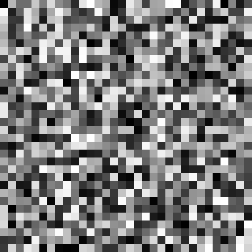

# example_procedural_tex

Sixteen procedural-texture algorithms, each with its own kernel, parameter panel and PNG output.

| | |
|---|---|
| Group | `gui` |
| Sources | `src/gui/procedural_tex/main.cpp`, `src/gui/procedural_tex/procedural_texture.h`, `src/gui/procedural_tex/noise_all.cpp`, `src/gui/procedural_tex/noise_*.cpp` |
| Backends | dx, vk, cuda |
| Build | `xmake build example_procedural_tex` |
| Run | `example_procedural_tex dx --capture procedural_tex.jpg` |



## Purpose

A small library of noise and pattern generators behind one uniform interface, for
picking a texture for a shader or studying how far a few lines of hash and interpolation
get. Headless mode is the default: every algorithm is generated, validated and
re-generated for a determinism check, and windows only open with `--gui`, so the example
is both a texture generator and a self test for sixteen kernels at once.

## Architecture

- **`ProceduralTexture`** is the interface every algorithm implements: `name()` for the
  window title and the file name, `generate(Image<float> &, Stream &)` to dispatch,
  `validate()` for the headless checks, `draw_ui()` for the parameter widgets.
  Parameters are kernel arguments, so moving a slider re-dispatches but never
  recompiles; kernels are compiled once, inside the factory.
- **Registry.** `create_all_procedural_textures` in `noise_all.cpp` returns sixteen
  algorithms in a fixed order: `white_noise`, `gaussian_noise`, `value_noise`,
  `perlin_noise`, `simplex_noise`, `worley_f1`, `worley_f2_minus_f1`, `plasma`, `fbm`,
  `turbulence`, `ridged_multifractal`, `pingpong`, `hetero_terrain`, `fractal_worley`,
  `domain_warp`, `perlin_worley`. Each lives in its own `noise_*.cpp`.
- **Generation.** Every algorithm dispatches a 2D kernel over `resolution x resolution`
  and writes RGBA float4 with RGB in `[0, 1]`. One `PixelStorage::FLOAT4` image per
  algorithm is created up front and reused, so a parameter change costs a dispatch, not
  an allocation.
- **Headless self test.** `headless_check` generates, reads back, validates (finite,
  inside `[0, 1]`, not constant, plus per-algorithm extras such as the contrast
  requirement of white noise), generates again and demands bit-exact equality. Results
  are logged per algorithm, and a problem is reported on that algorithm's line.
- **Pictures.** `--output-dir <dir>` writes one PNG per algorithm, named after it, for
  example `perlin_noise.png`. `--capture <file>` writes the *first* algorithm of the
  registry (`white_noise`) to exactly that path, with the container taken from the
  extension, and the remaining algorithms as `<name>.png` next to it.
- **GUI (`--gui`).** One `ImGuiWindow` hosts one window per algorithm, each with its
  parameter widgets, a Resolution combo (256, 512, 1024, 2048, 4096) and a Store button.
  `clear_to_grey` fills the framebuffer every frame; a texture is regenerated only when
  `draw_ui()` reports a change or the resolution changed, and Store writes
  `<algorithm>-<resolution>-<count>.png` into the working directory.

## Usage

```bash
# headless self test of all sixteen algorithms (the default)
example_procedural_tex dx
# one image for the first algorithm, the rest as <name>.png next to it
example_procedural_tex dx --capture procedural_tex.jpg
# every algorithm as its own PNG
example_procedural_tex dx --output-dir out --resolution 1024
# interactive windows (needs the gui module)
example_procedural_tex dx --gui
```

| Option | Meaning |
|---|---|
| `--capture <file>` | write the first algorithm to exactly this file (`.png`, `.jpg`/`.jpeg`, `.bmp`, `.tga` select the container, anything else falls back to PNG) |
| `--output-dir <dir>` | headless only: write one PNG per algorithm into this directory |
| `--resolution <n>` | texture size, clamped to `[64, 4096]` (default 512) |
| `--frames <n>` | headless only: how many passes over all algorithms run (default 1) |
| `--headless`, `--cli` | accepted for the shared convention; the default run is already window-less |
| `--gui` | open one ImGui window per algorithm |

## Result

Per-algorithm lines followed by a summary; with `--output-dir` each algorithm also logs
the file it wrote:

```text
[white_noise] OK (generate: ... ms / ... ms)
[white_noise] wrote out/white_noise.png
[perlin_noise] OK (generate: ... ms / ... ms)
Headless self-test passed (16 algorithms, 512x512, 1 pass(es)).
```

## See also

`example_image_process` (loads and recolours such a picture),
`example_procedural` (procedural shading in a path tracer), `example_imgui`.
