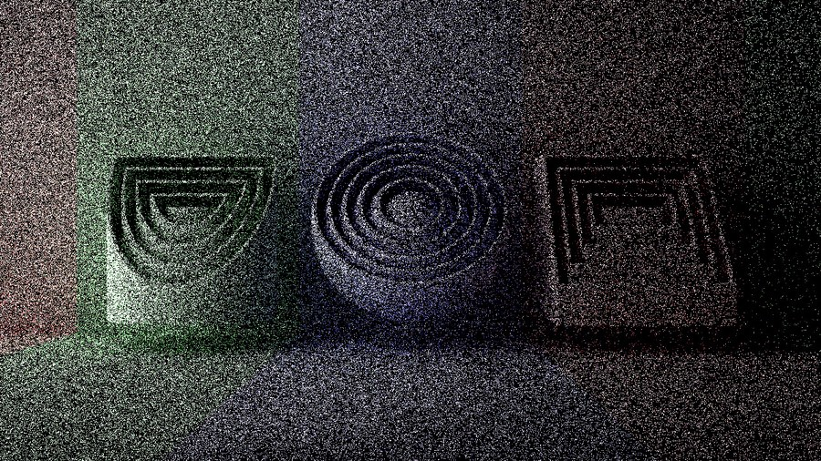

# example_sdf_renderer

A ray-marching path tracer over an analytic signed distance field — no meshes, no acceleration structure.

| | |
|---|---|
| Group | `rendering` |
| Sources | `src/rendering/sdf_renderer.cpp` |
| Backends | dx, vk, cuda |
| Build | `xmake build example_sdf_renderer` |
| Run | `example_sdf_renderer dx --headless --spp 64 --capture sdf.jpg` |



## Purpose

The scene is a function, not a mesh: a sphere, a box, a cylinder and a wall
combined with `min`, displaced by a high-frequency pattern, intersected with a
cutting plane. Rays advance by the distance they are from the surface, and the
shading is a small diffuse path tracer with an area light. It is the smallest
complete renderer in the group and the one to read first if you want the shape of
a LuisaCompute program without any asset pipeline.

## Architecture

- **The field.** `sdf(o)` builds a wall (`o.y + 0.1`, `o.z + 0.4`), a sphere, a
  rounded box and a cylinder in closed form, applies `make_nested` — a 40×
  sawtooth that turns the surface into a ridged pattern — and finally clips the
  result with a tilted half-space (`max(geometry, -(...))`).
- **Tracing.** `ray_march(p, d)` steps up to 100 times, stopping when the field
  drops below `1e-6`; `sdf_normal` differentiates the field with three central
  differences of `1e-3`; `next_hit(closest, normal, c, pos, d)` combines them and
  returns a grey albedo with a per-axis tint, so the shapes are distinguishable
  without textures.
- **The light.** `intersect_light(pos, d)` intersects the ray with the plane of a
  radius-2 disc at `light_pos`; if the hit is inside the disc the path terminates
  with `hit_light = 1`.
- **One kernel does everything.** `render_kernel` (16×8 block) takes
  `(seed_image, accum_image, frame_index)`. On frame 0 it writes the TEA seed and
  resets the accumulator; then it jitters the pixel, walks up to
  `max_ray_depth = 6` diffuse bounces with `out_dir` (cosine-weighted) and
  multiplies the throughput by the surface albedo. The result is folded in with a
  running average, `lerp(previous, sample, 1 / (frame_index + 1))`, so no separate
  accumulate pass exists and any frame count converges.
- **Host loop.** The image is 1280×720. `device.compile(render_kernel)` compiles
  the kernel once; the host queues `interval` frames per `CommandList` (4 with a
  window, 64 without), up to `total_spp`, then `hdr2ldr_kernel` divides by the
  sample count and applies `linear_to_srgb` before presenting or reading back.
- **Verification hooks.** `--compare` runs the usual image comparison;
  `--out_ref write <path>` dumps the raw `FLOAT4` accumulation buffer and
  `--out_ref read <path>` checks it with an absolute tolerance of `1e-5` and a
  relative one of `1e-4`, refusing non-finite values in either direction. That is
  the exact-value path for cross-backend work.
- **Build detail.** With the GUI module disabled the program forces the offline
  path, because nothing would drive the window loop.

## Usage

```bash
example_sdf_renderer dx                          # window with a live preview
example_sdf_renderer dx --headless --spp 64 --capture sdf.jpg
example_sdf_renderer dx --headless --spp 64 --out_ref write sdf.f32
```

| Option | Meaning |
|---|---|
| `--headless`, `--offline` | no window: render, write the image, exit |
| `--spp N` | accumulated samples per pixel; `0` means 1024 offline, unlimited in the window |
| `--capture <file>` | write the picture to exactly this file; the container follows the extension; implies the headless path |
| `--output-dir DIR` | directory for the default output `sdf-renderer.png` |
| `--out_ref write\|read <path>` | dump or check the raw float accumulation buffer |
| `--compare <file>`, `-c` | compare the result with a reference image, non-zero exit on mismatch |

## Result

A white-ish sphere, box and cylinder sitting on a striped wall under a soft
skylight, with strong contact darkening. The console reports throughput:

```
420 samples/s
Headless SDF render finished: 64 spp, wrote 'sdf.jpg'.
```

## See also

`example_path_tracing` for the mesh-based renderer,
`example_shader_toy` and `example_procedural` for other purely analytic scenes.
