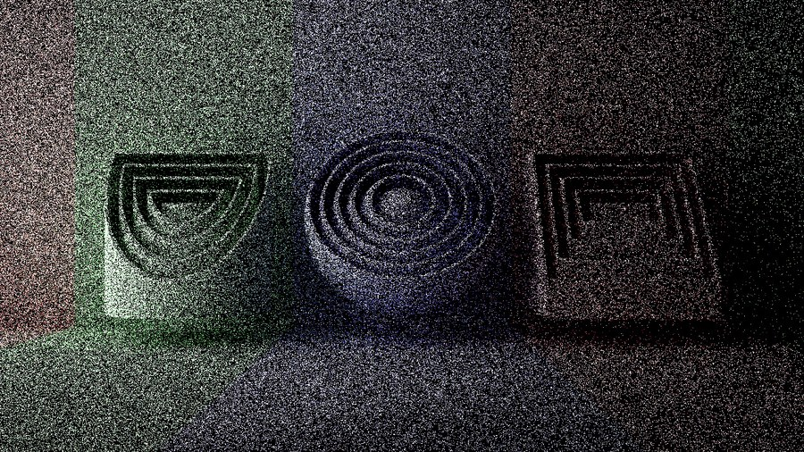

# example_sdf_renderer_xir2ast

The Taichi-style SDF path tracer, recorded to AST, translated to XIR and lowered
back to AST before it is compiled for the backend.

| | |
|---|---|
| Group | `rendering` |
| Sources | `src/rendering/sdf_renderer_xir2ast.cpp` |
| Backends | dx, vk, cuda |
| Build | `xmake build example_sdf_renderer_xir2ast` |
| Run | `example_sdf_renderer_xir2ast dx --headless --spp 256 --capture sdf.jpg` |



## Purpose

Same scene and same estimator as `example_sdf_renderer`: a sphere, a box and a
cylinder carved by a nested sine field, a wall and floor plane, one rectangular
area light, and a six-bounce walk that samples a cosine direction at every hit.
What this version adds is the compilation route. `render_kernel` is a normal DSL
lambda; before it reaches the backend it is translated to XIR
(`xir::ast_to_xir_translate`) and lowered back to AST
(`xir::xir_to_ast_translate`). The point for a user is that the round trip is
lossless: the SDF, the `$for`/`$if`/`$break` control flow, the `Callable`
composition (`sdf`, `ray_march`, `sdf_normal`, `next_hit`, `out_dir`) and the
`Image<uint>`/`Image<float>` arguments all survive it, and the rendered image is
the same picture.

## Architecture

**The scene.** `sdf(Float3 o)` combines a floor/wall plane
(`min(o.y + 0.1f, o.z + 0.4f)`), a sphere, a box and a cylinder, then passes the
result through `make_nested`, a 40× frequency fold that turns the surface into a
rippled shell, and clips it against a tilted plane. `ray_march`
takes up to 100 steps of `dist += sdf(p + dist * d)` and bails out on
`s <= 1e-6f | dist >= inf`; `sdf_normal` uses three forward differences at 1e-3;
`next_hit` writes `closest`, `normal` and the material colour `c` through
reference parameters, and `intersect_light` returns the distance to the light
rectangle or `1e10f`.

**The kernel.** `render_kernel` is a `Kernel2D` with `set_block_size(16, 8, 1)` and
the signature `(ImageUInt seed_image, ImageFloat accum_image, UInt frame_index)`.
On `frame_index == 0` it seeds the pixel with `tea(coord.x, coord.y)` and clears
the accumulator, then draws two numbers with `rand(seed)` for the jitter, builds the
camera ray from `camera_pos` and `fov`, and runs `$for (depth, max_ray_depth)` with
`max_ray_depth = 6`: `next_hit`, an `intersect_light` test that terminates the path
when the light is closer, `out_dir` for the next direction, and
`throughput *= c`. The result is folded into the accumulator with the running mean
`lerp(old, throughput * hit_light, 1 / (frame_index + 1))` and the seed is written
back, so successive dispatches are independent samples of the same pixel.

**The XIR round trip.** `build_xir_to_ast_kernel(const Function &)` translates the
recorded function, picks the first function tagged `xir::DerivedFunctionTag::KERNEL`
and returns `xir::xir_to_ast_translate(...)`. The example then compiles that
lowered function instead of the lambda:

```cpp
auto render_ast = build_xir_to_ast_kernel(render_kernel.function()->function());
auto render = device.compile(Kernel<2, Image<uint>, Image<float>, uint>{render_ast});
```

The kernel is recorded — and the round trip needs nothing but the recorded
function — before a device exists at all: the run logs `Recorded AST in ... ms`
before the backend is even selected. Recording and lowering are host-side steps, so
the translated AST can then be compiled for whichever device the user asked for.

**Output.** The loop accumulates in batches (`interval` frames per `CommandList`),
then `hdr2ldr_kernel` divides by the sample weight, applies `linear_to_srgb` and a
2.0 scale into a `BYTE4` image that is copied back and written as
`sdf-renderer.png` or the `--capture` path.

**One difference from `example_sdf_renderer`.** The two sources are otherwise the
same file, but their `rand` helper is not identical: the plain version divides the
full 32-bit LCG state by `UINT_MAX`, this one uses the low 24 bits
(`state & 0x00ffffffu`) scaled by 2^-24. Both are uniform, so both converge to the
same image, but a one-sample capture is a different noise realisation.

## Usage

```bash
example_sdf_renderer_xir2ast dx                              # window
example_sdf_renderer_xir2ast dx --headless --spp 256 --capture sdf.jpg
example_sdf_renderer_xir2ast cuda --headless --spp 16 -c ref.png
```

| Option | Meaning |
|---|---|
| `--headless` / `--offline` | Render without a window and exit |
| `--spp N` | Total samples per pixel (default 1024) |
| `--capture <file.png\|file.jpg>` | Destination file; the extension picks the container |
| `--output-dir DIR` | Directory for the default `sdf-renderer.png` |
| `--compare <ref.png>` / `-c <ref.png>` | PSNR check, non-zero exit on failure |

The backend is the first argument: `cuda`, `dx`, `vk`, `metal`, `hip` or
`fallback`. The target needs the LuisaCompute XIR module in the build
configuration.

## Result

A 1280×720 interior lit from the left: a rippled sphere, box and cylinder standing
on a plane against a wall, with the light falling off toward the right of the
frame. Low `--spp` values give a grainy image; a few hundred samples settle it.

## See also

`example_sdf_renderer` for the same scene without the XIR round trip,
`example_coro_sdf_renderer` for the same scene expressed as a coroutine.
