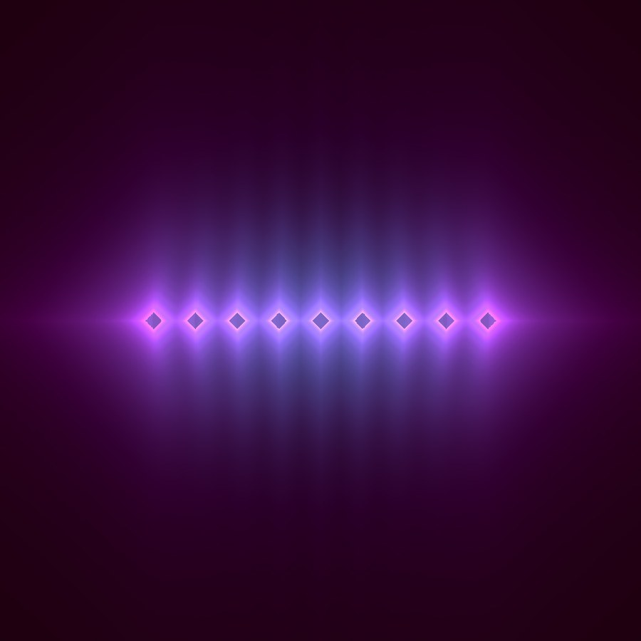

# example_shader_toy

ShaderToy-style ray marcher: an animated scene defined by a signed distance
function, shaded by distance-based colour accumulation instead of a light.

| | |
|---|---|
| Group | `rendering` |
| Sources | `src/rendering/shader_toy.cpp` |
| Backends | dx, vk, cuda |
| Build | `xmake build example_shader_toy` |
| Run | `example_shader_toy dx --headless --capture shader_toy.jpg` |



## Purpose

A compact demonstration of the "shadertoy" idiom in the LuisaCompute DSL: one
full-screen kernel, one time uniform, no geometry buffers at all. The picture
comes from folding the sample point through eight rotations and reflections and
adding a colour term at every marching step, so the example doubles as a tour of
`Callable` composition (`rotate`, `palette`, `map`, `rm`) and of `dynamic_range`
for a data-dependent march.

## Architecture

**Host setup.** There is nothing to upload. The example compiles two kernels and
creates one `Image<float>`: a window `Swapchain` storage when interactive, a
`PixelStorage::BYTE4` image otherwise. The stream follows the same split,
`StreamTag::GRAPHICS` for the window and `StreamTag::COMPUTE` for offline runs.

**The distance field.** `map(Float3 p, Float time)` repeats the point eight times
through `p = make_float3(abs(p.x) - 0.5f, p.y, abs(p.z) - 0.5f)` interleaved with
two 2D rotations of `time * 0.2` and `time * 1.89`, then returns
`dot(copysign(1.0f, p), p) * 0.2f` — an octahedral distance that never has to be
exact, only conservative.

**The march.** `rm(Float3 ro, Float3 rd, Float time)` walks `dynamic_range(64)`
steps: it evaluates `map`, breaks with `break_()` when `d < 0.02f | d > 100.0f`,
and otherwise accumulates `palette(length(p) * 0.1f) / (400.0f * d)` into `col`.
The returned `float4` carries the colour in `xyz` and `1.0f / (d * 100.0f)` in
`w` — an alpha that gets smaller the further the ray travelled.

**The kernels.** `clear_kernel` is a `Kernel2D` that fills the target with
`make_float4(make_float2(0.3f, 0.4f), 0.5f, 1.0f)`. `main_kernel` is a `Kernel2D`
taking `(ImageFloat image, Float time)`: it derives `uv` from `dispatch_id().xy()`
and `dispatch_size().xy()`, places the camera at
`make_float3(rotate(make_float2(0.0f, -50.0f), time), 0.0f).xzy()`, builds the
`cf` / `cs` / `cu` basis, calls `rm`, and blends the result over what is already
in the image with `lerp(color, old, alpha)`. That feedback is what gives the
animation its smear: each frame starts from the previous frame's pixels.

**Offline path.** `time` is pinned to `0.0f` and exactly one frame is rendered, so
`--capture` always produces the same still. The image is copied back with
`device_image.copy_to(luisa::span{host_image})` and written through
`image_io::write_image` to `test_shader_toy.png`, or to the `--capture` path,
whose extension decides the container. An optional `--compare` scores the result
against a reference PNG.

**Files.** A single translation unit, 1024×1024 output. `ENABLE_DISPLAY` (set from
`LUISA_ENABLE_GUI`) guards the `Window` and `Swapchain` code; a build without the
GUI module refuses a non-headless run instead of rendering nothing.

## Usage

```bash
example_shader_toy dx                              # animated window
example_shader_toy dx --headless --capture shader_toy.jpg
example_shader_toy vk --headless --capture shader_toy.png --output-dir out
```

| Option | Meaning |
|---|---|
| `--headless` / `--offline` | Render one frame without a window |
| `--capture <file.png\|file.jpg>` | Destination file; the extension picks the container |
| `--output-dir DIR` | Directory for the default `test_shader_toy.png` |
| `--compare <ref.png>` / `-c <ref.png>` | PSNR check against a reference, non-zero exit on failure |

The backend is always the first argument: `cuda`, `dx`, `vk`, `metal`, `hip` or
`fallback`.

## Result

A 1024×1024 abstract still: folded bands in violet and magenta over a dark blue
background, brightest along the folds where the march runs closest to the surface
and fading where it runs out of steps. In the window the same image is animated
and self-blended, so it drifts and smears with time.

## See also

`example_shader_visuals_present` for a longer march with reflections,
`example_shader_toy_spacex` for a texture-fed variant.
