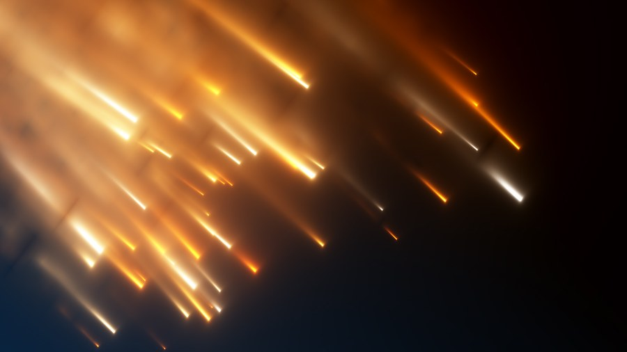

# example_shader_toy_spacex

XorDev's "Starship" shader ported to LuisaCompute: one full-screen kernel that
builds a fiery particle field by sampling a bindless texture fifty times.

| | |
|---|---|
| Group | `rendering` |
| Sources | `src/rendering/shader_toy_spacex.cpp` |
| Backends | dx, vk, cuda |
| Build | `xmake build example_shader_toy_spacex` |
| Run | `example_shader_toy_spacex dx --headless --capture spacex.jpg` |



## Purpose

A 512-character-style shader that depends on a *texture* rather than on geometry:
the whole picture is driven by repeatedly sampling one channel, so the example
exists to show how a bindless array, a sampler and a single `device.compile<2>`
kernel come together. It also demonstrates optional input: the same binary renders
a generated noise texture or any image the user passes on the command line.

## Architecture

**Input texture.** The optional positional argument after the backend is a path.
It is loaded with `stbi_load` as a single-channel `PixelStorage::BYTE1` image and
uploaded with `texture.copy_from(...)`. With no path the example synthesises a
128×128 BYTE1 noise image; the generator seeds `std::mt19937` with `42` in offline
mode and with `std::random_device{}()` in the window, so a headless capture is
reproducible while the interactive one keeps changing.

**Bindless channel.** `device.create_bindless_array(1u)` holds the image at slot
`0` together with `Sampler::linear_point_mirror()`, registered with
`bindless.emplace_on_update(0u, image, ...)` and published by `bindless.update()`
before the first dispatch.

**The shader.** `Callable main_image(BindlessVar iChannel0, Float iTime, Float2 I)`
is the shader proper. It builds `p` from `make_float2x2(4.f, -3.f, 3.f, 4.f) * ((I + I - r) / r.y)`,
then runs `$for (j, 50)`, one accumulation step per iteration. Each step samples
`iChannel0->tex2d(0u).sample(...)` at an exponentially shrinking scale, adds
`(cos(sin(i) * float4(1, 2, 3, 0)) + 1) * exp(sin(i + .1 * i * T))` divided by
`length(max(p, p / float2(s * 40, 2)))` to the accumulator `O`, and steps `p` with
`2 * cos(i * float2(11, 9) + i * i + T * .2)`. The result is
`tanh(clamp(.01 * p.y * float4(0, 1, 2, 3) + O * O / 1e4, -10, 10))`, i.e. a
squared accumulation compressed by `tanh` instead of a tonemap curve.

**Dispatch.** `device.compile<2>` wraps a lambda taking
`(ImageFloat output, BindlessVar iChannel0, Float iTime)`; the kernel writes
`make_float4(o.xyz(), 1.f)` at `dispatch_id().xy()` for a 1280×720 framebuffer,
either a `Swapchain` storage image or a `BYTE4` image.

**Offline path.** `time` stays `0.0f`, the kernel is dispatched `--frames` times
(the per-iteration cost is reported separately from the upload, so the number is
steady-state shader work), the framebuffer is copied back with `copy_to` and
written through `image_io::write_image` — `test_shader_toy_spacex.png` by default,
or the `--capture` path with any of `.png`, `.jpg`, `.jpeg`, `.bmp`, `.tga`.

**Files.** One translation unit. `ENABLE_DISPLAY` (from `LUISA_ENABLE_GUI`) guards
the `Window` titled `Starship` and its `Swapchain`; without the GUI module a
non-headless run stops with an error instead of silently rendering nothing.

## Usage

```bash
example_shader_toy_spacex dx                                   # generated noise
example_shader_toy_spacex dx photo.jpg                         # texture from file
example_shader_toy_spacex dx --headless --capture spacex.jpg
example_shader_toy_spacex cuda --headless --frames 8 -c ref.png
```

| Option | Meaning |
|---|---|
| `<backend>` | First argument: `cuda`, `dx`, `vk`, `metal`, `hip` or `fallback` |
| `<image>` | Optional texture, loaded single-channel; omit for generated noise |
| `--headless` / `--offline` | No window; also pins the noise seed to 42 |
| `--frames N` / `--iterations N` | How many times to dispatch before capturing |
| `--capture <file.png\|file.jpg>` | Destination file; the extension picks the container |
| `--output-dir DIR` | Directory for the default `test_shader_toy_spacex.png` |
| `--compare <ref.png>` / `-c <ref.png>` | PSNR check, non-zero exit on failure |

## Result

A warm 1280×720 frame: a bright orange-red mass fills the left half, breaks into
streaks and debris across the middle, and fades to black on the right. The random
noise texture decides the fine filament pattern; feeding a different image changes
that detail, not the composition.

## See also

`example_shader_toy` for a texture-free ray marcher,
`example_shader_visuals_present` for a longer, reflection-based showreel shader.
