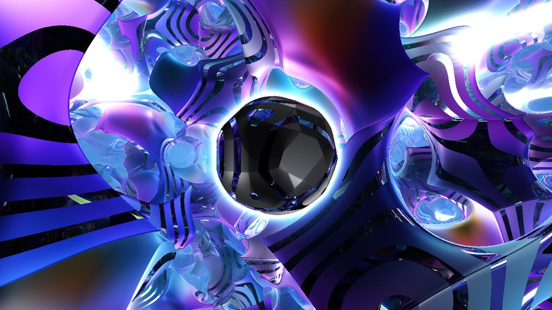

# example_shader_visuals_present

A beat-synchronised SDF showreel shader: an 80-step march with reflections,
glow accumulation, fog and a material palette driven by the same distance field.

| | |
|---|---|
| Group | `rendering` |
| Sources | `src/rendering/shader_visuals_present.cpp` |
| Backends | dx, vk, cuda |
| Build | `xmake build example_shader_visuals_present` |
| Run | `example_shader_visuals_present dx --headless --capture visuals.jpg` |



## Purpose

Where `example_shader_toy` accumulates colour along a march, this one keeps a full
shading state per pixel: it reflects the ray, attenuates it, tracks two glow terms
and blends fog, all in one loop. It is also a clear example of returning a
**struct** from a `Callable` — `SceneEvaluation` — so that one evaluation of the
field can feed the distance, the shading and the glow.

## Architecture

**Scene data on the host.** `struct SceneEvaluation` carries `distance`, `d1`,
`d2`, `d3`, `lazors`, `doodad` and `p2`, and is published to the DSL with
`LUISA_STRUCT(SceneEvaluation, distance, d1, d2, d3, lazors, doodad, p2)`. That
single declaration is what allows `evaluate_scene` to return `def<SceneEvaluation>(...)`
and the kernel to read `primary_evaluation.distance`, `.lazors`, `.p2` and so on.

**Building blocks.** Four `Callable`s do the geometry: `comp` is a repeated sphere
field (`p = asin(sin(p) * .9f)`, then `length(p) - 1.f`), `erot` rotates about an
axis, `smin` is a polynomial smooth minimum, and `wrot` is a 4D rotation used to
fold the scene. `evaluate_scene(Float3 p, Float t, Float time)` combines them: it
rotates `p` into `p2`, folds a `float4` through `wrot` gated by `smoothstep` of
`sin(bpt)`, builds the `doodad` box and the `lazors` line, samples `comp` three
times, and returns all of it packed in `SceneEvaluation`. `scene_distance` and
`scene_normal` are thin wrappers; the normal uses four explicitly sequenced
probes (`center_distance`, `x_distance`, `y_distance`, `z_distance`) so the
recorded AST keeps their order.

**The kernel.** `render_kernel` is a `Kernel2D` over 1280×720 taking
`(ImageFloat image, Float time)`. `bpm = 125.f` drives `bpt = time / 60 * bpm`,
the camera is placed from the beat value `bp`, and `$for (i, 80)` marches: each
step evaluates the scene, adds glow (`glo += .2f / (1.f + lazors * lazors * 20.f) * atten`),
and on a hit either breaks or, on the striped surfaces, reflects `cam` with
`reflect`, multiplies `atten` by `1 - |dot(cam, n)| * .98f` and continues. `fog`
accumulates as `dist * atten / 30.f`. After the loop the colour is assembled from
the material palette (`d1`, `d2`), a shadow term `ss` from one extra
`scene_distance` probe, a Fresnel-like `fact`, and finally `pow(color, 2.2f)`.

`clear_kernel` writes `make_float4(make_float2(0.3f, 0.4f), 0.5f, 1.0f)` before the
first dispatch; the render overwrites every pixel anyway.

**Offline path.** `time` is pinned to `0.0f` and one frame is dispatched, so
`--capture` is deterministic. The `BYTE4` image is copied back with `copy_to` and
written by `image_io::write_image` to `test_shader_visuals_present.png` or to the
`--capture` path; `--compare` then scores it against a reference PNG.

**Files.** One translation unit. `ENABLE_DISPLAY` (from `LUISA_ENABLE_GUI`) guards
the `Window` and `Swapchain`; the windowed loop feeds `clock.toc() * 1e-3` into the
kernel as `time` and presents each frame.

## Usage

```bash
example_shader_visuals_present dx                            # animated window
example_shader_visuals_present dx --headless --capture visuals.jpg
example_shader_visuals_present vk --headless -c ref.png --output-dir out
```

| Option | Meaning |
|---|---|
| `--headless` / `--offline` | Render one frame at `time = 0` and exit |
| `--capture <file.png\|file.jpg>` | Destination file; the extension picks the container |
| `--output-dir DIR` | Directory for the default `test_shader_visuals_present.png` |
| `--compare <ref.png>` / `-c <ref.png>` | PSNR check, non-zero exit on failure |

The backend is the first argument: `cuda`, `dx`, `vk`, `metal`, `hip` or
`fallback`.

## Result

A cool, high-contrast 1280×720 still: bright blue-white highlights over deep blue
shadow, with vertical structure on the right of the frame and a darker band across
the lower half where the fog term takes over. In the window the same scene pulses
with the 125 BPM beat as folds open and close.

## See also

`example_shader_toy` for the minimal version of this idiom,
`example_sdf_renderer` for an SDF scene that uses light sampling instead of a
colour palette.
