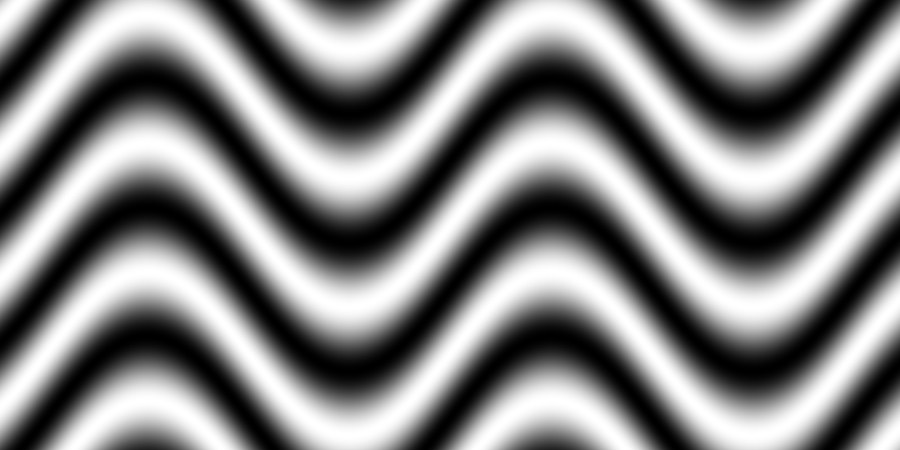

# example_swapchain

One device, four windows, four swapchains: the same rendered image presented to every window each frame.

| | |
|---|---|
| Group | `gui` |
| Sources | `src/gui/swapchain.cpp` |
| Backends | dx, vk, cuda |
| Build | `xmake build example_swapchain` |
| Run | `example_swapchain dx --headless --capture swapchain.jpg` |



## Purpose

The reference for the plain window-and-swapchain loop, extended to the case where one
rendered image has to reach several windows. It shows the `Window` / `Swapchain` pair,
how `SwapchainOption` is filled from a window's native display and handle, and how
`present()` queues a copy of a device image into a back buffer. Everything on screen
comes from one compute dispatch -- there is no render pass in the example at all.

## Architecture

- **Host side.** A 2048x1024 `PixelStorage::BYTE4` image is the only render target.
  A `PackagedWindow` struct holds a `Window` and a `Swapchain` together, because both
  must outlive the presentation loop and be destroyed in reverse order.
- **`draw`** (`device.compile<2>`, dispatched over 2048x1024) computes `uv` from the
  dispatch coordinates and writes three cosine waves with frequencies taken from
  `Constant<float>{pi, e, sqrt(2)}`, giving the slowly rotating colour field visible
  in the screenshot.
- **Windows.** Four windows are created in a loop, titled `Window #0` to `Window #3`,
  with sizes `resolution >> i`, so each window shows the same image at half the size
  of the previous one. Each swapchain is created with
  `SwapchainOption{.display = window.native_display(), .window = window.native_handle(),
  .size = resolution, .wants_hdr = false, .wants_vsync = false, .back_buffer_count = 3}`;
  the display and handle are backend-opaque values, which is why the same code works
  on dx, vk and cuda.
- **Frame loop.** One dispatch of `draw`, then `swapchain.present(image)` for every
  window, in the same stream, so the four presentations are ordered after the
  rendering. `Framerate framerate` turns the loop into a reported FPS figure, and
  `window.poll_events()` is called for each window after presenting.
- **Headless path.** No window and no swapchain are created: the shader is dispatched
  `frames` times into an offscreen image, which is copied back and written as
  `gui_swapchain.png` (or to `--capture`).

## Usage

```bash
# interactive (needs a window and the gui module)
example_swapchain dx

# headless: offscreen frames, one image out
example_swapchain dx --headless --frames 8 --capture swapchain.jpg
example_swapchain dx --headless --output-dir out
```

| Option | Meaning |
|---|---|
| `--headless`, `--cli` | no window, no swapchain; render offscreen and write an image |
| `--frames N` | how many frames of the animated background are rendered (default: 1) |
| `--capture <file>` | write the image to exactly this file (`.png`, `.jpg`/`.jpeg`, `.bmp`, `.tga` select the container, anything else falls back to PNG); implies the headless path |
| `--output-dir <dir>` | where the default `gui_swapchain.png` goes (default: the working directory) |

## Result

Four windows of decreasing size, all showing the same colour field, with the FPS
figure logged every frame. The headless run prints the resolution and timing:

```text
Headless swapchain: 8 frame(s) at 2048x1024 rendered ... (no window, no swapchain), wrote 'swapchain.jpg'.
```

## See also

`example_swapchain_static` (a single window showing a loaded image),
`example_imgui` (a swapchain driven by Dear ImGui), and the platform-hosted variants
`example_swapchain_wx` / `example_swapchain_qt`.
