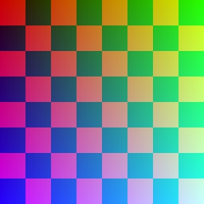

# example_swapchain_static

Loads a PNG, uploads it once and presents the same still image through a swapchain.

| | |
|---|---|
| Group | `gui` |
| Sources | `src/gui/swapchain_static.cpp` |
| Backends | dx, vk, cuda |
| Build | `xmake build example_swapchain_static` |
| Run | `example_swapchain_static dx --headless --frames 4 --capture swapchain_static.jpg` |



## Purpose

The shortest complete present loop in the gallery: one image, one swapchain, no
rendering. It is the example to read when you want to know how an asset gets from disk
into a window, because it shows the two upload directions (`stbi_load` into host
memory, `copy_from` into a device image) and nothing else. It also demonstrates that
`present()` accepts an image the GPU never rendered this frame.

## Architecture

- **Host side.** `stbi_load("src/tests/logo.png", ...)` decodes the file to RGBA8; the
  image is created with `PixelStorage::BYTE4` at exactly the decoded size and filled
  with one `image.copy_from(luisa::span{pixels, width * height * 4})` followed by
  `synchronize()`. The file is a relative path, so the example is meant to be started
  from the repository root.
- **Stand-in image.** The logo does not ship with every checkout. If `stbi_load`
  returns null and the run is headless, a 256x256 image is generated on the host (a
  checkerboard with horizontal red and vertical blue ramps) and used instead, so an
  unattended run still produces a deterministic picture.
- **Window and swapchain.** `Window window{"Display", resolution}` plus
  `SwapchainOption{.display = window.native_display(), .window = window.native_handle(),
  .size = resolution, .wants_hdr = false, .wants_vsync = true, .back_buffer_count = 8}`.
  Eight back buffers and vsync keep the busy loop cheap; the stream is created with
  `StreamTag::GRAPHICS`.
- **Present loop.** Nothing is rendered: the loop submits `swapchain.present(image)`,
  records a frame with `Framerate` and prints the reported FPS, then polls events.
  Because the image is immutable after the upload, the GPU only copies it.
- **Headless path.** No window and no swapchain: the image is copied back to host
  memory `frames` times and written once as `gui_swapchain_static.png` (or to
  `--capture`). The copy-back loop still exercises the upload and the stream ordering.

## Usage

```bash
# interactive (needs a window and the gui module)
example_swapchain_static dx

# headless: four readbacks, one image out
example_swapchain_static dx --headless --frames 4 --capture swapchain_static.jpg
example_swapchain_static dx --headless --output-dir out
```

| Option | Meaning |
|---|---|
| `--headless`, `--cli` | no window, no swapchain; read the image back and write it |
| `--frames N` | how many times the image is presented (or copied back) (default: 1) |
| `--capture <file>` | write the image to exactly this file (`.png`, `.jpg`/`.jpeg`, `.bmp`, `.tga` select the container, anything else falls back to PNG); implies the headless path |
| `--output-dir <dir>` | where the default `gui_swapchain_static.png` goes (default: the working directory) |

## Result

The logo (or the generated stand-in) in a window, with a steady FPS figure in the log:

```text
Cannot load 'src/tests/logo.png'; generating a stand-in image.
Headless swapchain_static: 4 frame(s) of 256x256 ... (no window, no swapchain), wrote 'swapchain_static.jpg'.
```

## See also

`example_swapchain` (four windows and rendered content), `example_win_hdr` (the same
idea with an HDR swapchain), `example_imgui` (ImGui draws the image).
