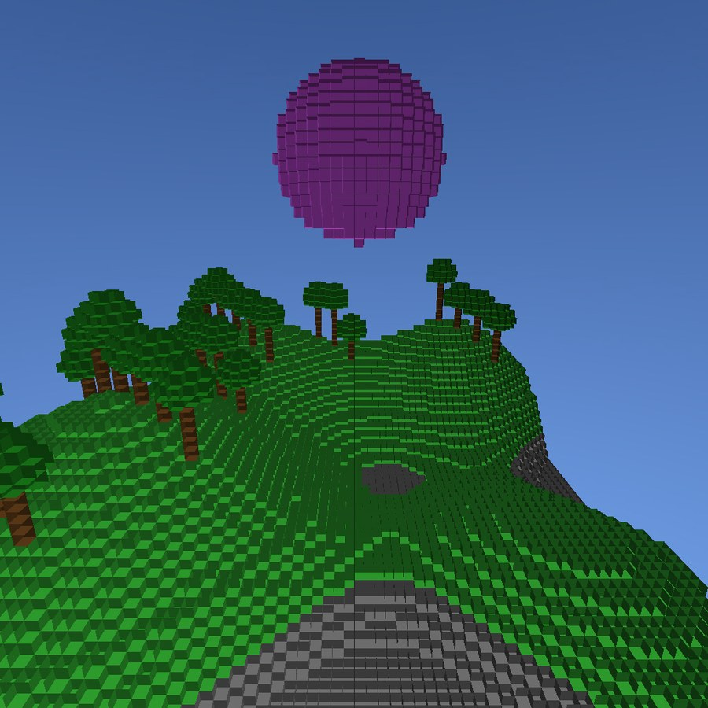

# example_voxel_raytracer

Voxel ray tracer: walks a 64×64×64 voxel grid with a DDA loop and shades the first solid cell it meets.

| | |
|---|---|
| Group | `rendering` |
| Sources | `src/rendering/voxel_raytracer.cpp` |
| Backends | dx, vk, cuda |
| Build | `xmake build example_voxel_raytracer` |
| Run | `example_voxel_raytracer dx --headless --frames 4 --capture voxel.jpg` |



## Purpose

A self-contained renderer: no acceleration structure, no scene file, only a
`Buffer<uint>` of packed voxels. It shows how far a single `Kernel2D` can carry a
renderer — ray/box intersection, a front-to-back voxel walk, a normal rebuilt from
the traversal, and ambient occlusion derived from the step count — and how one
compiled kernel feeds a window or an image.

## Architecture

**Host setup.** The grid is built on the CPU into `luisa::vector<uint> host_voxels`
(64³ = 262 144 entries, `0` = empty). A lambda `set_voxel(x, y, z, type)` writes
`type` into `(z * grid_size + y) * grid_size + x`; the scene is a sine-wave terrain
(type `1` dirt, `2` grass, `3` stone), trees placed where `(x * 7 + z * 13) % 47 == 0`
(`4` wood, `5` leaves) and a floating sphere at `(32, 45, 32)` with radius 8
(type `6`). `stream << voxel_grid.copy_from(luisa::span{host_voxels}) << synchronize()`
uploads it once.

**The kernel.** `render_kernel` is a `Kernel2D` with
`set_block_size(16, 16, 1)` and the signature
`(ImageFloat image, Float3 cam_pos, Float2 cam_rot, BufferVar<uint> voxels)`.
Per pixel it builds a ray from `dispatch_id().xy()`, applies yaw and pitch from
`cam_rot`, then hits the grid box with the slab method (`tmin`/`tmax`,
`t_enter`/`t_exit`, sky gradient when `t_enter > t_exit`). Inside the box the walk
keeps `vx`/`vy`/`vz`, the per-axis `step_x`/`step_y`/`step_z`, the
`delta_tx`/`delta_ty`/`delta_tz` costs and the `next_tx`/`next_ty`/`next_tz`
crossings as `Var`s in a `$for (step, max_steps)` loop (`max_steps = 256`), pulling
`voxels.read(...)` at each cell and breaking on the first non-zero type or when it
leaves the grid.

**Shading.** The hit cell's type selects a colour through `$if` / `$elif`; the
normal is rebuilt from the axis that was stepped last, lit by one directional
light (`normalize(0.5, 1, 0.3)`), and modulated by
`ao = 1 - (hit_step / max_steps) * 0.5`.

**Offline path.** The stream is created with `StreamTag::COMPUTE`, the kernel is
dispatched `--frames` times back to back, timed with `Clock`, then
`display.copy_to(luisa::span{host_image})` brings the `BYTE4` image home and
`image_io::write_image` writes `test_voxel_raytracer.png` — or exactly the file
named by `--capture`. The extension of that path picks the container (`.png`,
`.jpg`, `.jpeg`, `.bmp`, `.tga`).

**Offline vs. windowed.** Without `--headless` (and with the GUI module enabled)
the example adds a `Window` titled `Voxel Ray Tracer` and a `Swapchain` created
from `SwapchainOption{.wants_vsync = true}`, keeps the stream on
`StreamTag::GRAPHICS`, and presents each frame while arrow keys rotate, `W`/`S`
zoom, `R` resets, and mouse drag/scroll feed the pointer callbacks.

## Usage

```bash
example_voxel_raytracer dx                        # interactive window
example_voxel_raytracer dx --headless             # one frame, default name
example_voxel_raytracer dx --headless --frames 4 --capture voxel.jpg
```

| Option | Meaning |
|---|---|
| `--headless` / `--offline` | No window, no swapchain; render and exit |
| `--frames N` / `--iterations N` | Dispatch the kernel `N` times and report ms/iteration |
| `--capture <file.png\|file.jpg>` | Write to this file instead of `<output-dir>/test_voxel_raytracer.png` |
| `--output-dir DIR` | Directory for the default output name |
| `--compare <ref.png>` / `-c <ref.png>` | PSNR check against a reference image; non-zero exit on failure |

The first argument after the executable is always the backend: `cuda`, `dx`,
`vk`, `metal`, `hip` or `fallback`.

## Result

A 1024×1024 landscape: grass-covered terrain, trees with rounded canopies, a
glowing purple orb above them, and a sky gradient behind. Traversal steps set the
ambient occlusion, so contact areas darken and open ground stays bright.

## See also

`example_sdf_renderer` for a signed-distance scene, `example_procedural` for the
acceleration-structure path with ray queries.
