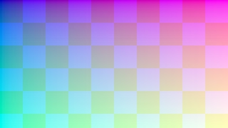

# example_win_hdr

HDR presentation through the DirectX HDR extension: query the display, pick a colour space, and encode the frame for it in a compute shader.

| | |
|---|---|
| Group | `gui` |
| Sources | `src/gui/win_hdr.cpp` |
| Backends | dx, vk, cuda (headless); dx for the HDR window |
| Build | `xmake build example_win_hdr` |
| Run | `example_win_hdr dx --headless --frames 8 --capture win_hdr.jpg` |



## Purpose

The only example that talks to a backend extension rather than to the portable API: it
uses `DXHDRExt` to find out what the attached display can do, creates a swapchain with
a 10-bit or 16-bit back buffer, and encodes the frame so that the compositor shows the
intended brightness. It is also a compact reference for the two transfer functions
involved -- ST.2084 (PQ) for HDR10 output and sRGB for everything else.

## Architecture

- **Host side.** The picture is loaded with `stbi_load` and uploaded to a
  `PixelStorage::BYTE4` image with six mip levels; the sample file
  `genshin_start.jpg` does not ship with the repository, so a 320x180 stand-in
  gradient/checker is generated when it is missing. The stream is
  `StreamTag::GRAPHICS` when a window is open and `StreamTag::COMPUTE` otherwise.
- **Headless path.** No window, no extension call and no HDR swapchain: `ldr_image`
  is a plain `PixelStorage::BYTE4` image, `mode` stays 0, and the composite runs in
  sRGB. This is why the example runs on any backend.
- **Interactive path.** The window is always created on the `dx` backend, whatever
  `<backend>` says, because that is what the example demonstrates. From
  `device.extension<DXHDRExt>()` it reads `device_support_hdr()`, then
  `get_display_data(window->native_handle())` for the display's bit depth, colour
  space, primaries and luminance range. The white point becomes
  `max_luminance / 80`, and the bit depth chooses `PixelStorage::R10G10B10A2` with
  `ColorSpace::RGB_FULL_G2084_NONE_P2020` or `PixelStorage::HALF4` with
  `RGB_FULL_G10_NONE_P709`. `DXSwapchainOption` carries the window handle, size,
  storage and `wants_vsync`; `set_color_space` publishes the choice.
- **Encoding.** `output_storage = swap_chain.backend_storage()` decides the kernel's
  mode: `0` sRGB (`BYTE4`), `1` 10-bit PQ, `2` linear (`HALF4`). Three callables do the
  maths: `rec709_to_rec2020` (a 3x3 matrix), `linear_to_st2084` (the PQ curve with its
  `m1`, `m2`, `c1`, `c2`, `c3` constants) and `linear_to_srgb`.
- **`hdr2ldr_kernel`** is a 2D shader over the image size. It fades the texture in with
  `lerp(float4(1), hdr_image.read(coord), inter_val)`, scales by the white point times
  a light factor, and `$switch`es on the mode to apply the right transfer function
  before writing.
- **Fade-in.** Both paths animate the same curve: the light factor ramps over the
  first three quarters of the run and the fade-in completes at the end. Offline, frame
  `f` of `N` uses `time = (f + 1) * 4 / N`, so `--frames 8` reaches full brightness on
  the last frame and `--frames 1` writes the finished picture.

## Usage

```bash
# interactive on an HDR display (always uses the dx backend)
example_win_hdr dx

# headless on any backend: sRGB composite of the stand-in or the real image
example_win_hdr dx --headless --frames 8 --capture win_hdr.jpg
example_win_hdr vk --headless --output-dir out
```

| Option | Meaning |
|---|---|
| `<backend>` | which device the headless path uses; the interactive path always creates a `dx` device, whatever the word says |
| `--headless`, `--cli` | no window, no HDR swapchain; composite in sRGB and write an image |
| `--frames N` | how many composite frames run, which is also the fade-in resolution (default: 1) |
| `--capture <file>` | write the image to exactly this file (`.png`, `.jpg`/`.jpeg`, `.bmp`, `.tga` select the container, anything else falls back to PNG); implies the headless path |
| `--output-dir <dir>` | where the default `gui_win_hdr.png` goes (default: the working directory) |

## Result

In a window on an HDR-capable display, the image brightens as the light factor ramps
up; the display capabilities are logged once at startup. The headless run reports:

```text
Cannot load 'genshin_start.jpg'; generating a stand-in image.
Headless win_hdr: 8 frame(s) of 320x180 sRGB composite ... (no window, no HDR swapchain), wrote 'win_hdr.jpg'.
```

## See also

`example_swapchain_static` (an SDR swapchain presenting the same kind of image),
`example_swapchain` (several windows), `example_imgui` (ImGui on a swapchain).
