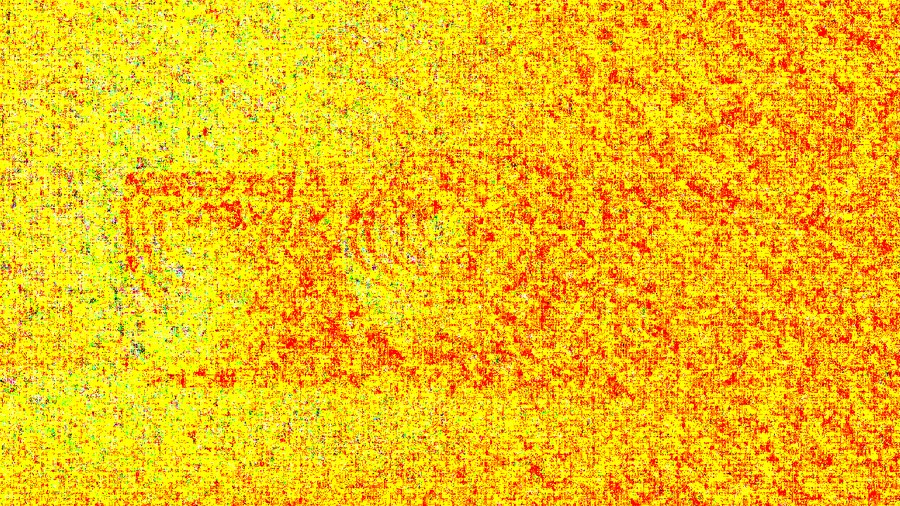

# luisa_ntc_viewer

Previews the channels of an NTC material — in a window, or offscreen into `viewer_output.png` for scripts and docs.

| | |
|---|---|
| Group | `ntc` |
| Sources | `src/ntc/tools/luisa_ntc_viewer.cpp`, `src/ntc/include/libntc/ntex_container.h`, `src/ntc/include/libntc/infer_engine.h`, `src/ntc/include/libntc/buffer_copy.h` |
| Backends | dx, vk, cuda |
| Build | `xmake build luisa_ntc_viewer` |
| Run | `luisa_ntc_viewer --ntc=data/ntc/material.ntc --backend=dx --headless` |



## Purpose

The visual end of the NTC pipeline: decode a container with the inference engine and see what actually came back. Selecting a texture, a channel and a mip level by hand is how you judge whether a training run converged, and the headless render is how you put that judgement into a report or a CI artefact.

## Architecture

- Load. `NtexContainer::load_from_file` reads the container description, `InferEngine::load_container` uploads the latent grid and the MLP, and `decompress_mip_device(mip, w, h)` reconstructs the selected mip as interleaved FP32 channels on the device.
- Blit. A single `Kernel2D` reads the packed channel block per texel (`base = (y * width + x) * 16 + channel_offset`), clamps three consecutive channels into `[0, 1]` and writes them into a `BYTE4` image, so the display shows one texture's `firstChannel..firstChannel+2` as RGB.
- Window mode (GUI builds). A GLFW `Window` plus a `Swapchain` on a graphics stream; the title reports `[texture/size: name (Ch a-b)] Mip: n (w x h)` and every change re-decodes only when the mip changes.
- Headless mode. `--headless` renders the same image offscreen and writes `viewer_output.png` (into `--output-dir` when given) without creating a swapchain, then exits.
- Selection. `--channel=N` picks the texture whose channel range contains `N` — the default `1` lands on the albedo entry, which owns channels 0–3 — and `--mip=N` is clamped to the available mip count.

## Usage

The sample container comes from `data/`, restored with `python scripts/unpack_data.py` (`data/ntc/material.ntc`, a 1280×720 four-channel material).

```bash
luisa_ntc_viewer --ntc=data/ntc/material.ntc --backend=dx
luisa_ntc_viewer --ntc=data/ntc/material.ntc --backend=vk --channel=1 --mip=0
luisa_ntc_viewer --ntc=data/ntc/material.ntc --backend=cuda --headless --output-dir captures
```

| Option | Meaning |
|---|---|
| `--ntc=<file.ntc>` | container to display; a bare `*.ntc` argument works too |
| `--backend=<name>` | `cuda` (default), `dx` or `vk` |
| `--channel=N` | channel index used to choose the texture (default 1) |
| `--mip=N` | mip level to decode, clamped to the container's mip count (default 0) |
| `--headless` | render one texture offscreen to `viewer_output.png` and exit |
| `--output-dir DIR` | directory for `viewer_output.png` |
| `--frames N` | accepted by the shared parser; a single frame is rendered |

Window controls: `A`/`D` or `←`/`→` switch texture, `W`/`S` or `↑`/`↓` switch mip level, `1`–`n` jump straight to texture *n*, `ESC` quits.

## Result

The picture above is the headless render of `data/ntc/material.ntc`: the albedo channels of the sample material at mip 0, 1280×720, written as `viewer_output.png`.

```text
[info] luisa_ntc_viewer: wrote 'captures/viewer_output.png' (1280x720, mip 0, headless).
```

A wrong path or a container the library cannot parse ends the run with `File not found: ...` or `Failed to load .ntc file: ...` and a non-zero exit code.

## See also

luisa_ntc_cli (produces the container this tool shows and decompresses it to PNG/DDS), luisa_ntc_bench (decode and transcode throughput), luisa_ntc_test (numerical parity of the same decode).
